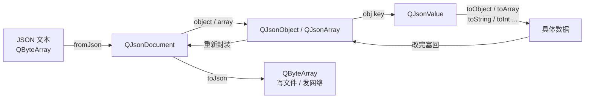

# Qt JSON 核心类笔记

> [!abstract] 一句话
> ==`QJsonDocument` 管「文本 ↔ 树」的进出==，`QJsonObject` / [[QJsonArray]] 管树的结构，`QJsonValue` 是树上每一个节点外面的「万能盒子」。

---

## 整体链路



输入输出的**统一载体都是 [[QByteArray]]**：读文件用 `QFile::readAll()`，读字符串用 `QString::toUtf8()`；写出去再交给 `QFile::write()`。

---

## QJsonDocument

> [!note] 定位
> 解析与序列化的**入口/容器**，本身不直接存键值对。输入吃 `QByteArray`，输出吐 `QByteArray`。

**读（解析）**
```cpp
QJsonParseError err;
QJsonDocument doc = QJsonDocument::fromJson(bytes, &err);
if (err.error != QJsonParseError::NoError) {
    qWarning() << err.errorString() << "@" << err.offset;
}
```

**写（序列化）**：`doc.toJson(format)` → `QByteArray`

| 格式 | 样子 | 用在哪 |
|---|---|---|
| `QJsonDocument::Compact` | `{"age":25,"name":"Alice"}` 单行 | 网络传输、省体积 |
| `QJsonDocument::Indented` | 多行 + 4 空格缩进 | 配置文件、调试日志 |

```cpp
doc.toJson(QJsonDocument::Compact);   // 单行
doc.toJson(QJsonDocument::Indented);  // 带缩进（也是不传参时的默认值，但建议显式写）
```

> [!tip] 别只记 `object()`
> 根节点不一定是 `{}`，也可能是 `[]`。先判 `doc.isObject()` / `doc.isArray()`，再调 `doc.object()` / `doc.array()`；对数组文档调 `object()` 会拿到空对象。

> 另有 `toBinaryData()` / `fromBinaryData()`，是 Qt 私有二进制格式，**不是标准 JSON**，别拿去和别的语言互通。

---

## QJsonObject

> [!info] 定位
> 由 `doc.object()` 取得，对应 JSON 的 `{ }`，内部是 ==`QString → QJsonValue`== 的键值对。

```json
{
  "name": "test",
  "list": [],
  "info": {}
}
```

```cpp
QJsonObject obj = doc.object();
QJsonValue v = obj.value("name");   // 或 obj["name"]
```

键不存在时 `obj["x"]` 返回的是 `Null` 值，不是报错 —— 所以 `contains()` + 类型判断比直接 `toString()` 稳。

---

## QJsonValue

> [!warning] 最容易绕晕的一个
> 从 `QJsonObject` 或 [[QJsonArray]] 里**取出来的永远先是 `QJsonValue`**，不是具体类型。它盒子里可能装：数字 / 字符串 / 布尔 / null / `QJsonObject` / `QJsonArray`。

因为值本身可能又是对象或数组，所以它提供两组「拆盒」接口：

| 方向 | 接口 |
|---|---|
| 拆成结构 | `toObject()` → `QJsonObject`，`toArray()` → `QJsonArray` |
| 拆成基础值 | `toString()`、`toInt()`、`toDouble()`、`toBool()` |
| 先看再拆 | `isObject()`、`isArray()`、`isString()`、`isDouble()`、`isNull()` |

```cpp
QJsonValue v = obj["list"];
if (v.isArray()) {
    QJsonArray arr = v.toArray();   // ✅ 必须显式转
}
// QJsonArray arr = obj["list"];   // ❌ 右边是 QJsonValue，不能直接赋
```

> [!danger] 临时值改了不回写
> `obj["list"].toArray().append("x")` 改的是临时副本，**原对象不变**。
> 正确姿势：取出 → 改 → 塞回去
> ```cpp
> QJsonArray arr = obj["list"].toArray();
> arr.append("x");
> obj["list"] = arr;
> ```

---

## QJsonArray（补上，逻辑才闭合）

对应 `[ ]`，==每个元素依旧是 `QJsonValue`==，所以数组里可以混着字符串、数字、嵌套对象、嵌套数组：

```cpp
QJsonArray arr;
arr.append(10);
arr.append("hello");
arr.append(obj);      // 塞对象
arr.append(arr);      // 塞数组（嵌套）

for (const QJsonValue &v : arr) {
    if (v.isObject()) /* ... */;
}
```

---

## 避坑清单

- [ ] 取结构前先 `isArray()` / `isObject()`，别盲转
- [ ] 根节点可能是数组，别默认 `doc.object()`
- [ ] 改嵌套结构要「取出 → 改 → 重新赋值」
- [ ] 数字统一按 `double` 存，超大整数建议走字符串
- [ ] `toJson()` 默认把非 ASCII 转成 `\uXXXX`，合法 JSON，中文看着像乱码而已
- [ ] 始终接住 `QJsonParseError`，外部数据别裸解析

---

## 相关笔记

[[QByteArray]] · [[QFile]] · [[QJsonArray]] · [[QJsonParseError]] · [[JSON]] · [[QtCore]] · [[Qt 文件读写]]
