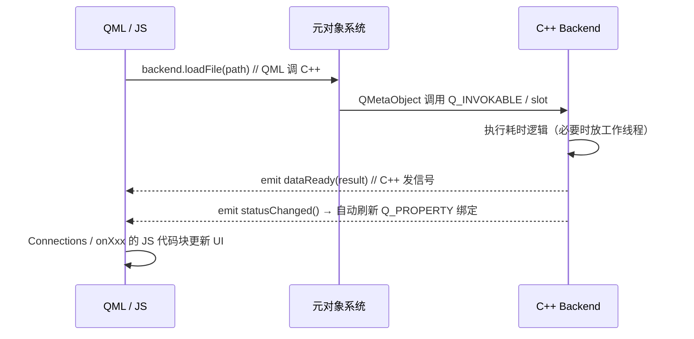
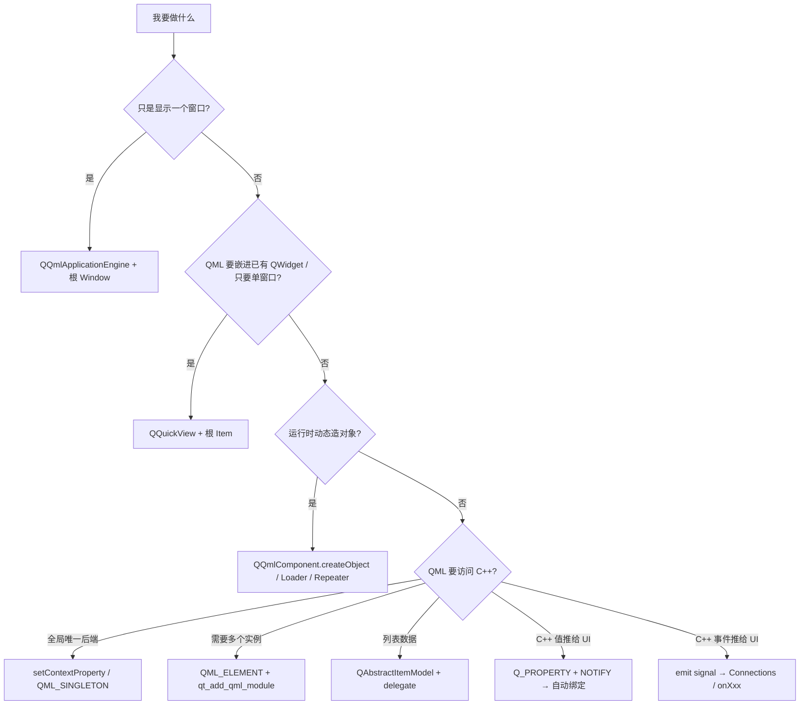

# QML 主要知识点

> [!abstract] 一句话抓住主线
> QML 是**声明式语言**，Qt Quick 是**基于它的 UI 框架**，C++ 是**业务逻辑后端**。三根支柱：**对象树 + 属性绑定 + 信号/处理器**。你原稿的四大特性方向都对，但有两处要掰开：①「模块相互独立」这条原则对、**举的例子在 Qt 6 已经过时**；②「qml 加载 C++ 路径」其实写的是 **C++ 侧加载 QML 的三种宿主方式**，和「QML 调 C++」是两组完全不同的机制。

## 🗺 笔记地图

- [[QML 属性绑定与坑]]
- [[QML 组件化与自定义类型]]
- [[QML 信号与处理器]]
- [[QML 状态机与动画]]
- [[QML import 与模块]]
- [[QML 与 C++ 集成]]
- [[Qt 5 到 Qt 6 的 QML 迁移]]

%% 以上是建议拆成的子笔记；单篇使用时删掉本段，双链在 Obsidian 里仍可点开新建 %%

---

## 0. 先分清三个名字

| 名词 | 是什么 |
| --- | --- |
| **QML** | 语言/文件格式（`.qml`），声明式 + 内嵌 JavaScript 表达式，描述一棵对象树 |
| **Qt Quick** | 基于 QML 的 UI 框架：标准类型库（Item、Rectangle、Text、Window…）+ 场景图（Scene Graph）渲染 |
| **Qt QML 模块** | 提供 `QQmlEngine`、类型注册、上下文、组件加载等运行时能力 |
| **Qt Quick Controls / Layouts / Shapes / Models** | 独立 URI 的附加模块，各自 import，不属于 QtQuick |

> [!info] 类比
> QML : Qt Quick ≈ HTML/CSS : 浏览器渲染引擎；JavaScript 只做**胶水逻辑**（事件响应、简单变换），重逻辑、IO、算法、线程活儿交给 C++。

---

## 1. 四大特性（原稿修订版）

### 1.1 声明式编程 ✅

描述「界面长什么样、状态之间怎么变」，而不是「先 new、再 setGeometry、再 addWidget、再 show」的步骤序列。

```qml
import QtQuick

Rectangle {
    width: 200; height: 100
    color: pressed ? "tomato" : "steelblue"   // 描述关系，不写重绘代码
    Text { anchors.centerIn: parent; text: "Hello" }
}
```

> [!tip] 代价与边界
> 声明式换来的是「引擎替你追踪依赖并刷新」，代价是**不能依赖绑定求值顺序**，且复杂绑定（多行、循环、副作用）会拖性能、难调试——这时候该把表达式抽成 `function` 或交给 C++。

### 1.2 属性绑定 ⚠️ 原稿漏了最关键的坑

绑定 = 把属性赋成一个 JS 表达式，引擎**自动追踪表达式里的依赖**，依赖变 → 重新求值 → 写回属性。

```qml
Rectangle {
    id: box
    width: 100
    height: width * 0.6                 // 绑定：width 变，height 自动跟
    color: width > 150 ? "red" : "blue"
}
```

> [!danger] 命令式赋值会**永久断开**绑定（最高频 bug）
> ```qml
> Component.onCompleted: box.height = 80    // ❌ 之后 width 再变，height 不动了
> Component.onCompleted: box.height = Qt.binding(() => box.width * 0.6)  // ✅ 重新建立绑定
> ```
> 也可用独立的 `Binding { target: box; property: "height"; value: box.width * 0.6 }`。这是从 QWidget 思维转过来最容易踩的坑：Qt 属性 `setXxx()` 不删绑定，**QML 里 JS 的 `=` 会删**。
> 另外注意**绑定循环**（A 绑 B、B 又绑 A，运行时报 `Binding loop detected`），布局里 `implicitWidth/implicitHeight` 互绑尤其常见。

| 相关语法 | 作用 |
| --- | --- |
| `property int count: 0` | 声明自定义属性（**尽量用具体类型，别滥用 `property var`**，便于 qmllint / qmlsc 编译优化） |
| `property alias label: title.text` | 别名：把内部对象属性**直接透出**，双向、无拷贝，组件封装首选 |
| `readonly property` / `required property` | 只读 / 必须由使用方传入（Qt 6 推荐，替代隐式约定） |
| `default property` | 默认属性：子组件不写属性名时自动归入，如 `Item.data` |

### 1.3 组件化与复用 ✅（补精确口径）

> [!success] 每个 `.qml` 文件就是一个类型
> 文件名即类型名，**必须以大写字母开头**（`MyButton.qml` → `MyButton`），由字母/数字/下划线组成；引擎自动把它识别为类型定义。同目录下的 `.qml` **无需 import 直接可用**；要跨目录发布就做 QML 模块（`qmldir` + `qt_add_qml_module`）。

原稿「**根元素决定复用关系**」更准确的说法：

- 根对象决定**组件继承的类型**——`MyCard.qml` 根是 `Rectangle`，那它天然拥有 Rectangle 的全部属性，可当 Rectangle 用；根是 `Item` 则更轻量；根是 `QtObject` 则纯逻辑、无视觉。
- 根是 `Window` 时，它不是「可嵌套的组件」，而是一个**独立顶层窗口**（嵌套声明只表示 transient 父子窗口关系）。可复用组件一律用 Item 系，别用 Window。

**对外三件套**

```qml
// MyButton.qml
import QtQuick

Rectangle {
    id: root
    // 1) 对外接口 = property（+ alias / required / readonly）
    property string label: "OK"
    required property int badgeCount
    property alias bg: root.color
    readonly property bool hot: badgeCount > 0

    // 2) 对外通知 = signal；自动获得 on<Signal> 处理器
    signal clicked(string where)
    signal countChangedExternally(int n)

    // 3) 对外行为 = function / JS 方法
    function reset() { badgeCount = 0 }

    width: 120; height: 40
    color: hot ? "orange" : "gainsboro"
    Text { anchors.centerIn: parent; text: root.label }

    MouseArea {
        anchors.fill: parent
        onClicked: root.clicked("body")     // 内部触发对外信号
    }
}
```

```qml
// 使用方：文件名即类型名，信号处理器自动叫 onClicked
MyButton {
    label: "保存"
    badgeCount: 3
    onClicked: (where) => console.log("点了", where)   // 槽就是 JS 代码块 ✅ 原稿这点对
    onBadgeCountChanged: console.log(badgeCount)      // 每个 property 自动生成 onXxxChanged
}
```

| 机制 | 用途 |
| --- | --- |
| `property` / `property alias` / `required` | 对外输入与暴露 |
| `signal` + `on<Signal>` | 对外事件通知 |
| `function` | 对外方法 |
| `Component { id: delegate }` + `Loader` / `Repeater` / `ListView` | 延迟创建、模板复用、模型驱动列表 |
| `qmldir` / QML 模块 / `import <URI>` | 跨目录、跨项目分发 |

> [!warning] 组件化两条纪律
> 1. 组件内部只通过 `id: root` 引用自己，别直接写外部 id（作用域泄漏）。
> 2. 别在组件里写死业务数据；输入靠 property，输出靠 signal，状态尽量由外部绑定驱动。

### 1.4 内置状态机与动画 ✅（补另一半）

原稿的 `states / when / transitions` 是对的：用声明式描述状态差异，避免一堆 `if-else` 手动改属性。

```qml
Rectangle {
    id: light
    property bool running: false
    color: "red"                       // 默认状态名是 ""（初始属性即默认态）
    states: [
        State {
            name: "go"
            when: light.running        // ✅ 条件成立自动切，无需手写 state = "go"
            PropertyChanges { target: light; color: "green" }
        }
    ]
    transitions: [
        Transition {
            from: "*"; to: "*"
            ColorAnimation { target: light; duration: 300 }
        }
    ]
    MouseArea { anchors.fill: parent; onClicked: light.running = !light.running }
}
```

> [!tip] 补上原稿没提的两点
> - `PropertyChanges` 只写**相对默认态的差异**，回默认态会自动恢复原绑定——这正是它比 JS 手动赋值优雅的地方。
> - 动画不止 `transitions` 一条路：
>   | 方式 | 适用 |
>   | --- | --- |
>   | `Behavior on x { NumberAnimation { duration: 200 } }` | **某个属性任何变化**都自动补间，最常用 |
>   | `Transition` + `Animation` | 状态切换过程的编排 |
>   | 独立 `NumberAnimation` / `PropertyAnimation` / `SequentialAnimation` | 显式播放、`onClicked: anim.start()` |
>   | `SpringAnimation` / `SmoothedAnimation` | 物理感跟手动画 |

---

## 2. import 与模块化 ⚠️ 原稿最需要改的一节

### 2.1 版本号规则：原话是对的，但要加 Qt 版本限定

官方文档：版本号 `Major.Minor` **可省略，此时导入模块最新版本**；**只省略次版本号，则导入该主版本下最新次版本**。`as <Namespace>` 可把类型装进局部命名空间避免重名冲突。

| 写法 | 含义 |
| --- | --- |
| `import QtQuick` | 无版本导入 → 该模块最新版本（**Qt 6 推荐写法**） |
| `import QtQuick 2` | 只给主版本 → 2.x 下最新次版本 |
| `import QtQuick 2.15` | 精确锁定 → **封顶 API**，2.16 / 6.x 新增类型在该文件不可用 |
| `import QtQuick as QQ` | 局部命名空间，用 `QQ.Rectangle` 访问 |

> [!danger] Qt 5 / Qt 6 完全相反的默认习惯
> - **Qt 5**：模块按 URI 严格隔离且**必须写版本号**，`import QtQuick 2.15` / `import QtQuick.Window 2.15`，不写就导入失败。
> - **Qt 6**：官方推荐**全部不带版本号**（versionless imports）。写 `import QtQuick 2.15` 反而会封顶 API、让 qmllint / QML Language Server 报「找不到类型」。
> - 所以要跨 Qt 5/6 兼容的库才保留显式版本；纯 Qt 6 项目一律省略。

### 2.2 「模块相互独立」原则对，例子过时了

> [!warning] 原稿「import QtQuick 不会自动带入 QtQuick.Window，需各自显式导入」
> 这是 **Qt 5 的正确经验**。`Window` 在 Qt 5 属于 `QtQuick.Window 2.x`，必须单独导入；但 **Qt 6 已把 Window/Screen 等类型并入 QtQuick 模块**——官方《使用 QML 的第一步》里 `import QtQuick` 后直接写 `Window { }`，并明确说明 Window 与 Text 都由 QtQuick 提供。

| 场景 | 结论 |
| --- | --- |
| Qt 6 + 只用 `Window` | `import QtQuick` 就够；Qt Creator 模板 / qml-book 仍保留 `import QtQuick.Window` 一行，是历史习惯，写了不报错，但不少 lint 规则已判为冗余 |
| Qt 5（或需双版本兼容） | 必须 `import QtQuick.Window 2.x` |
| `QtQuick.Controls`、`QtQuick.Layouts`、`QtQuick.Shapes`、`QtQml.Models`、`QtQuick.Dialogs` | **永远要各自显式 import** —— 「模块相互独立」原则在这里依然成立 |
| `Qt.labs.*` | 实验模块，API 不保证稳定，别写进长期代码 |

```qml
// Qt 6 典型头部
import QtQuick
import QtQuick.Controls
import QtQuick.Layouts
import MyCompany.Controls 1.0 as MC     // 自定义模块 + 命名空间
import "utils.js" as Utils              // 本地 JS 资源（必须带 as）
```

> [!tip] 其他 import 形态
> - **目录导入**：`import "../controls"`（相对路径），原型期方便，发布请用 QML 模块。
> - **JS 资源**：`import "math.js" as Math`；Qt 6 也可用 ES 模块 `.mjs`。`Qt.include()` 自 Qt 5.14 弃用，别再用。
> - **冲突时**用 `as` 命名空间，别靠 import 顺序碰运气。

---

## 3. 「加载」与「通信」是两组机制（核心纠错）

> [!danger] 原稿标题写的是「qml 加载 C++ 路径」，但列的三条其实是 **C++ 侧如何加载一个 QML 文档**
> 这两件事要分开记：
> - **宿主/加载**：C++ 怎么把 QML 跑起来 → `QQmlApplicationEngine` / `QQuickView` / `QQmlComponent` / `QQuickWidget`
> - **互通**：QML 怎么访问 C++ → 上下文属性 / 类型注册 / 单例 / 模型

### 3.1 C++ 加载 QML 的三种方式

| 方式 | 根元素 | 自身是窗口吗 | 适用 | 原稿评价 |
| --- | --- | --- | --- | --- |
| `QQmlApplicationEngine` + `load(QUrl)` | **Window / ApplicationWindow**（根为纯 Item 时引擎**不会**自动建窗口，界面不可见） | 否，QML 自己声明窗口 | ✅ **主流**，纯 QML 应用、多窗口、App 生命周期 | 「注册对象」说法不准：它是**加载器**，暴露对象要另配 `setContextProperty` / 类型注册 |
| `QQuickView` + `setSource(QUrl)` | **必须是 Item 及子类，不能是 Window** | ✅ 它**继承自 QQuickWindow，本身就是窗口** | 单窗口、QML 嵌进已有 C++ 应用、原型 | 「自带一个 Window，多窗口麻烦」方向对：多窗口得建多个 QQuickView，或换 QQmlApplicationEngine |
| `QQmlComponent` + `create()` / `createObject()` | 任意 | 否，只是对象工厂 | 动态创建对象、弹窗、插件 | ✅ 「底层机制，一般不直接用」正确：Loader / Repeater / delegate 内部就是它，需自己管上下文与生命周期 |
| `QQuickWidget`（补充） | Item | 是 QWidget | QWidget 项目里嵌一块 QML | 混用 QWidget 与场景图时有渲染/叠加限制，新项目优先纯 QML |

> [!warning] 两个经典报错
> - `QQuickView does not support using a window as a root item` → QML 根写成了 `Window`。改成 `Item`，或换 `QQmlApplicationEngine`。
> - 加载后出现**两个窗口** → 同一份 QML 既被 QQuickView 包了窗口，里面又声明了 Window。
> - `QQmlApplicationEngine` 要判断加载成败：连 `objectCreated` 信号检查 object 是否为 nullptr，别假设一定成功。

```cpp
// 主流写法：QQmlApplicationEngine + 根 Window
#include <QGuiApplication>
#include <QQmlApplicationEngine>

int main(int argc, char *argv[]) {
    QGuiApplication app(argc, argv);
    QQmlApplicationEngine engine;                 // ⚠️ 必须在 app 之后创建
    // Qt 6.5+：加载失败直接退出；旧版本改连 objectCreated 检查 nullptr
    QObject::connect(&engine, &QQmlApplicationEngine::objectCreationFailed,
                     &app, [] { QCoreApplication::exit(-1); }, Qt::QueuedConnection);
    engine.loadFromModule("MyApp", "Main");       // Qt 6 + qt_add_qml_module；或 engine.load(QUrl("qrc:/Main.qml"))
    return app.exec();
}
```

```cpp
// 单窗口/嵌入式：QQuickView，QML 根必须是 Item
QQuickView view;
view.setSource(QUrl(QStringLiteral("qrc:/Panel.qml")));
view.setResizeMode(QQuickView::SizeRootObjectToView);
view.show();
```

### 3.2 QML 访问 C++ 的四条路

| 方式 | C++ 侧 | QML 侧 | 适用 |
| --- | --- | --- | --- |
| **上下文属性**（原稿说的「注册对象」） | `engine.rootContext()->setContextProperty("backend", &obj)` | 直接 `backend.doSomething()` | 全局单例式后端；**必须在 load 之前设置**，否则 `ReferenceError` |
| **注册可实例化类型** | `qmlRegisterType<Backend>("com.my.app", 1, 0, "Backend")` 或 Qt 6 `QML_ELEMENT` + `qt_add_qml_module` | `import com.my.app` → `Backend { }` | 需要多个实例、可复用组件 |
| **注册单例** | `qmlRegisterSingletonInstance(...)` / `QML_SINGLETON` | `import` 后直接 `Settings.theme` | 配置管理器、全局服务；**Qt 6 推荐**，工具链友好、可 AOT 编译 |
| **模型** | `QAbstractItemModel` 子类 / `QStringList` / `QList<QObject*>` | `ListView { model: cppModel; delegate: ... }` | 列表/表格数据，比逐个 setProperty 高一个量级 |

> [!success] Qt 6 首选：声明式注册
> 类里加 `QML_ELEMENT` / `QML_SINGLETON`（头文件需能被 include 路径直接找到），CMake 配 `qt_add_qml_module(...)`，引擎自动完成注册。好处是 **QML Language Server / qmllint / qmlsc（QML 编译成 C++）都能看见类型**；手写 `qmlRegisterType` 会挡住这条优化路径。

### 3.3 双向通信链路（原稿描述 ✅，补三个前提）



原稿这句**基本正确**：「qml 调用注册对象的方法 → 执行 C++ 函数 → C++ 通过信号 → qml 连接信号槽 → 槽函数一般是 JS 代码做逻辑处理」。补上让它真正能跑的条件：

```cpp
// Backend.h —— 四个必要条件缺一不可
#include <QObject>
#include <qqmlregistration.h>

class Backend : public QObject {
    Q_OBJECT
    QML_ELEMENT                                     // ① Qt 6 注册（或 qmlRegisterType）
    Q_PROPERTY(QString status READ status NOTIFY statusChanged)  // ② 属性绑定要靠 NOTIFY
public:
    explicit Backend(QObject *parent = nullptr) : QObject(parent) {}  // ③ 构造函数带 parent
    QString status() const { return m_status; }

    Q_INVOKABLE void loadFile(const QString &path); // ④ 方法进元对象系统（或 public slots）
    Q_INVOKABLE QJsonObject query(int id);          // 可返回 JSON 可序列化类型
    void finish(const QString &s) { m_status = s; emit statusChanged(); emit dataReady(s); }
signals:
    void statusChanged();
    void dataReady(const QString &text);
private:
    QString m_status;
};
```

```qml
import QtQuick
import QtQuick.Controls
import MyApp            // qt_add_qml_module 定义的 URI

Window {
    visible: true; width: 400; height: 300

    // 方式 A：上下文属性 / C++ 单例对象
    Text { id: label; text: backend.status }     // ✅ Q_PROPERTY + NOTIFY → 自动刷新，不用手写 JS
    Connections {
        target: backend
        function onDataReady(text) { label.text = text }   // Qt 6 推荐 function 写法（有参数校验）
        // 也可写 onDataReady: (text) => label.text = text
    }
    Button { onClicked: backend.loadFile("/tmp/a.txt") }

    // 方式 B：注册类型，QML 自己实例化
    Backend {
        id: localBackend
        onStatusChanged: console.log("status:", localBackend.status)
    }
}
```

> [!warning] 四个必须记住的细节
> 1. **C++ 侧**：`Q_OBJECT` + `Q_INVOKABLE` / `public slots` + `Q_PROPERTY(... NOTIFY ...)` + `Q_ENUM`（枚举要过桥），否则 QML 看不见。
> 2. **`NOTIFY` 是属性绑定自动刷新的开关**。只发信号、靠 JS 手动赋值，等于放弃了声明式最值钱的部分；输出型数据优先做成 `Q_PROPERTY`。
> 3. **上下文属性必须在 `load()` 之前设置**；加载后再设会 `ReferenceError`，且运行中改上下文会导致该上下文所有绑定重算，性能差。
> 4. **QML 侧槽确实是 JS**（代码块 / `function` / `signal.connect(fn)`），但 JS 只做胶水；耗时、IO、加解密、大循环放 C++ 工作线程，结果用信号回 GUI 线程。QML 引擎本身跑在 GUI 线程，别在 JS 里阻塞。

> [!tip] 反向也支持，但少用
> QML 信号 → C++ 槽：`findChild<QObject*>("objId")` 后 `QObject::connect`（QML 对象运行时才存在，只能用字符串/旧式或 `QMetaObject::invokeMethod`）；C++ 调 QML 函数也走 `QMetaObject::invokeMethod(QVariant...)`。**架构上更推荐 C++ 完全不反向依赖 QML 对象**，只通过属性/信号解耦。

---

## 4. 补全：信号、作用域与生命周期

| 主题 | 要点 |
| --- | --- |
| 信号声明 | `signal clicked(string where)` → 自动获得 `onClicked` 处理器，参数名在处理器内直接用 |
| 属性变化信号 | 每个 property 自动生成 `on<Property>Changed`，无需自己声明 |
| 任意信号连接 | `Connections { target: obj; function onFoo(a) {...} }`；或 `obj.foo.connect(fn)` / `signal-to-signal` |
| 附加信号/属性 | `Component.onCompleted` / `Component.onDestruction`、`Layout.fillWidth`、`Keys.onPressed`、`Window.active` |
| 作用域 | `id` 在整个组件内可见（跨文件不可见）、`parent` 指**视觉父**、`root` 惯例指组件自身；`Qt.*` / `Math` / `console` 是全局 |
| 对象树 | 子对象自动进 `children` / `data`（默认属性）；销毁父对象会销毁整棵子树 |
| 布局 | `anchors`（相对父子/兄弟）、`Row/Column/Grid`（定位器）、`RowLayout/ColumnLayout/GridLayout`（尺寸协商），别手写 `x: a.width + b.width` |
| 生命周期 | `Component.onCompleted`、`Loader` 的 `active/source` 控制延迟创建、`Qt.callLater()` 推迟到下一帧 |
| 类型 | 优先具体类型（`int/string/real/color/url`），少用 `var`；Qt 6 支持 `required property`、类型断言、`qmllint` 静态检查 |

---

## 5. 工程化速查

| 想做的事 | 做法 |
| --- | --- |
| 原型预览 | `qml Main.qml`（或 Qt Creator 的 Qt Quick UI Prototype），不用写 main.cpp |
| 新建 Qt 6 项目 | CMake + `qt_add_qml_module` 注册 QML 文件与 C++ 类型，`qt_standard_project_setup()` |
| 静态检查 / 格式化 | `qmllint`、`qmlformat --sort-imports` |
| 性能 | 简单绑定、避免 `clip`/半透明滥用、大列表用 `ListView` + delegate 复用、C++ 类型用 `QML_ELEMENT` 让 qmlsc 编译成 C++ |
| 多窗口 | `QQmlApplicationEngine` + QML 里多个 `Window` / `ApplicationWindow`；别用多个 QQuickView 硬凑 |
| 资源 | `.qrc` 或 `qt_add_resources`，QML 里走 `qrc:/`，避免 `file://` 路径问题 |
| 国际化 | `qsTr()` + `lupdate` / `lrelease` |
| 平台 | 桌面/嵌入式优先；移动端也能用，但触摸交互与 DPI 要单独调 |

> [!danger] 别把 JS 当业务层
> QML 内嵌 JS 适合事件响应、格式转换、状态拼装；一旦出现网络请求、文件遍历、算法循环、加密、数据库，就该下沉成 C++ 的 `Q_INVOKABLE` 或模型。否则绑定重算会把这段 JS 反复执行，界面掉帧且难定位。

---

## 6. Qt 5 → Qt 6 差异速查

| 项 | Qt 5 | Qt 6 |
| --- | --- | --- |
| import 版本 | 必须写 `2.15` | 推荐**不写**，写了会封顶 API |
| `Window` | 在 `QtQuick.Window 2.x`，必须单独 import | 并入 `QtQuick`，`import QtQuick` 即可（旧写法仍兼容） |
| C++ 类型注册 | `qmlRegisterType()` 手写 | `QML_ELEMENT` / `QML_SINGLETON` + `qt_add_qml_module` |
| 加载入口 | `engine.load(QUrl("qrc:/main.qml"))` | 仍可用，另加 `engine.loadFromModule("URI", "Main")` |
| 信号处理器 | `onFoo: ...` | 新增推荐 `function onFoo(arg) { ... }`（带参数类型检查） |
| JS 模块 | `import "x.js" as X`、`Qt.include()` | ES 模块 `.mjs`，`Qt.include()` 弃用 |
| 编译 | 解释执行为主 | `qmlsc` / Qt Quick Compiler 可把 QML 编译成 C++，前提是类型对工具链可见 |

---

## 7. 原稿 → 修订对照

| 原稿表述 | 修订后 |
| --- | --- |
| 「声明式：只描述界面长什么样和状态之间怎么改变」 | ✅ 正确；补「不能依赖绑定求值顺序」「复杂绑定下沉 C++」 |
| 「属性绑定」 | ✅ 正确，但**补最关键坑**：命令式 `=` 永久断开绑定，用 `Qt.binding(() => ...)` / `Binding` 恢复；补 `alias`/`required`/`readonly`、绑定循环 |
| 「每个 .qml 文件就是一个类型」 | ✅ 官方原文；补文件名须**大写开头**、同目录免 import、模块靠 `qmldir`/`qt_add_qml_module` |
| 「根元素决定复用关系」 | 精确为：根对象决定**组件继承的类型**与是否可嵌套；根为 `Window` 时是独立顶层窗口，不适合做可复用组件 |
| 「对外接口靠 property，对外通知靠 signal」 | ✅ 正确；补 `property alias`（透出内部属性）、`required`、`function`、`on<Property>Changed` 自动生成、`Component`/`Loader`/`Repeater` 复用机制 |
| 「states / when / transitions 用声明式描述状态切换」 | ✅ 正确；补默认态为 `""`、`PropertyChanges` 只写相对默认态的差异、回退自动恢复绑定，以及另一半：`Behavior` + 独立 Animation |
| 「省略版本号 = 最新；只写主版本 = 该主版本最新次版本」 | ✅ 官方原话；补 **Qt 5 必须写版本 / Qt 6 推荐全不写**，写死版本会封顶 API 并让工具链报错 |
| 「import QtQuick 不会自动带入 QtQuick.Window，需各自显式导入」 | ⚠️ **Qt 5 正确、Qt 6 过时**：Qt 6 的 `Window`/`Screen` 已并入 `QtQuick`，官方示例 `import QtQuick` 后直接写 `Window`；`QtQuick.Window` 仅作兼容导入。但 Controls/Layouts/Shapes/Models 等**仍必须各自 import**，模块独立原则本身成立 |
| 「qml 加载 C++ 路径：QQmlApplicationEngine 注册对象 / QQuickView / QQmlComponent」 | 归类纠正：这三条是 **C++ 加载 QML 的宿主方式**，不是 QML 访问 C++。补 `QQuickWidget` 第四种；`QQmlApplicationEngine` 是加载器不是注册器；`QQuickView` 自身即 `QQuickWindow`、**根元素不能是 Window**；`QQmlComponent::create()` 确为底层机制 |
| 「QML 调注册对象的方法 → C++ 函数 → C++ 发信号 → QML 信号槽 + JS 槽函数」 | ✅ 主线正确；补四个前提：`Q_OBJECT` + `Q_INVOKABLE`/slots + `Q_PROPERTY(... NOTIFY ...)` + 注册时机在 load 前；补 `Connections` 写法、`Q_PROPERTY` 自动刷新绑定优于手动赋值、Qt 6 声明式注册、模型/单例/反向调用、耗时操作下沉工作线程 |

---

## 8. 速查：什么时候用哪个



---

## 参考

- Qt 官方：[QML 第一步](https://doc.qt.io/qt-6/qmlfirststeps.html) · [导入语句](https://doc.qt.io/qt-6/zh/qtqml-syntax-imports.html)
- Qt 官方：[通过 QML 文档定义对象类型](https://doc.qt.io/qt-6/zh/qtqml-documents-definetypes.html) · [属性绑定](https://doc.qt.io/qt-6/qtqml-syntax-propertybinding.html)
- Qt 官方：[信号与处理器事件系统](https://doc.qt.io/qt-6/qtqml-syntax-signals.html) · [States and Transitions](https://www.qt.io/product/qt6/qml-book/ch05-fluid-states-transitions)
- Qt 官方：[QML 与 C++ 集成概述](https://doc.qt.io/qt-6/qtqml-cppintegration-overview.html) · [上下文属性](https://doc.qt.io/qt-6/qtqml-cppintegration-contextproperties.html) · [在 C++ 中定义 QML 类型](https://doc.qt.io/qt-6/qtqml-cppintegration-definetypes.html)
- Qt 官方：[QQuickView](https://doc.qt.io/qt-6/qquickview.html) · [QQmlApplicationEngine](https://doc.qt.io/qt-6/qqmlapplicationengine.html) · [QQmlComponent](https://doc.qt.io/qt-6/qqmlcomponent.html)
- Qt 官方博客：[QML Runtime features: part 1](https://www.qt.io/blog/qml-runtime-features-part-1)（Window 与 Item 两种根对象的由来）

#Qt/QML #Qt/QtQuick
