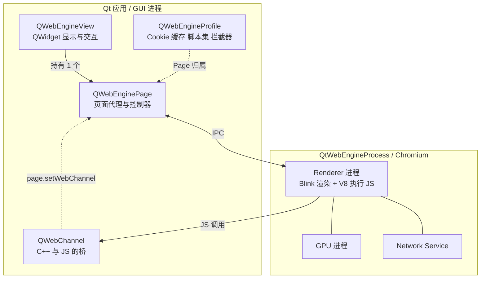
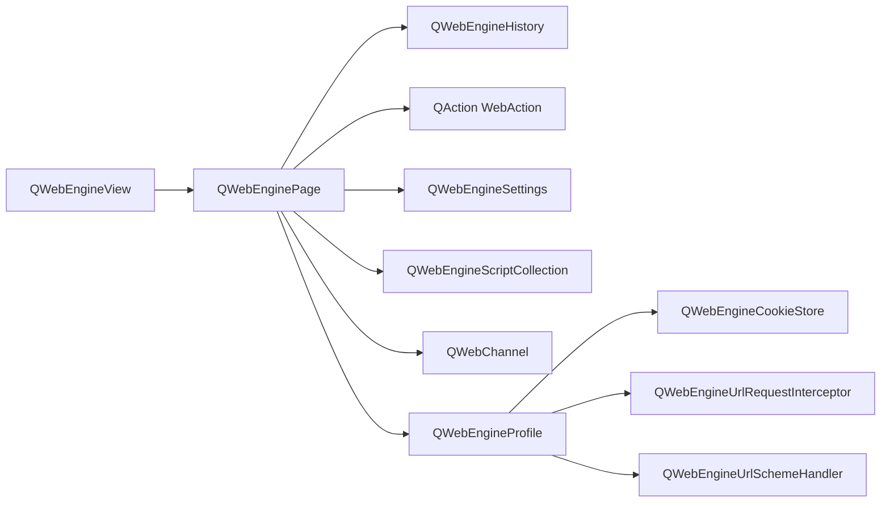
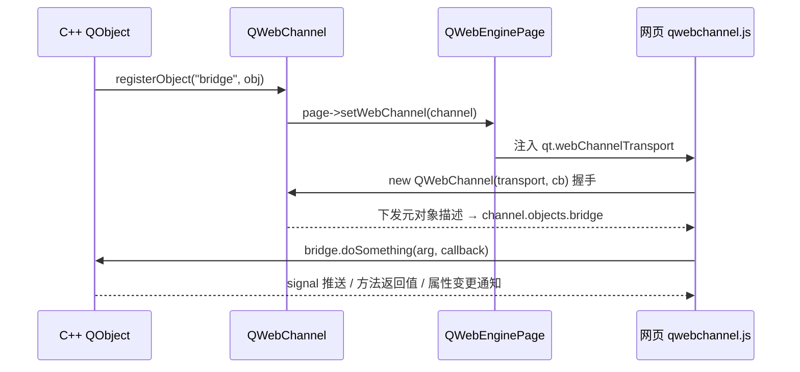
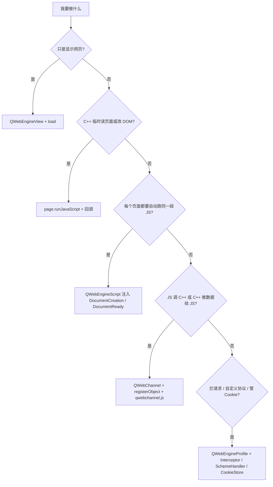

# Qt WebEngine 知识梳理

> [!abstract] 一句话抓住主线
> Qt WebEngine = **Chromium 内核 + Qt 封装层**。对象层级是 `QWebEngineView（控件） → QWebEnginePage（页面代理） → QWebEngineProfile（会话资源）`，而**真正的 HTML 渲染与 JS 执行在独立的 QtWebEngineProcess 里**。你原稿里说的「通道」是独立的 **Qt WebChannel 模块**，它和「执行 JavaScript」是三件不同的事，不要混成一个。

## 🗺 笔记地图

- [[QWebEngineView 与 QWebEnginePage]]
- [[QWebEngineProfile 与会话隔离]]
- [[Qt WebChannel 双向通信]]
- [[QWebEngineScript 脚本注入]]
- [[QWebEngineUrlSchemeHandler 自定义协议]]
- [[Chromium 多进程与沙箱]]
- [[Qt WebEngine 部署与打包]]

%% 以上是建议拆成的子笔记；单篇使用时删掉本段，双链在 Obsidian 里仍可点开新建 %%

---

## 1. 先纠正最关键的一点：是三层，不是两层

> [!danger] 原稿「渲染和导航由 QWebEnginePage 执行」
> 方向对，但要再精确一层：`QWebEnginePage` 是**主进程侧的页面控制器/文档代理**，它**发起**导航、持有历史与动作、转发脚本调用；真正的 HTML 解析、布局、绘制、V8 执行 JavaScript 都在**独立的 QtWebEngineProcess（渲染进程）**里完成，通过 IPC 与 Qt 应用通信。Qt 官方概述明确写了「Page rendering and JavaScript execution are separated from the GUI process into the Qt WebEngine Process」。

| 层 | 谁 | 跑在哪个进程 | 干什么 |
| --- | --- | --- | --- |
| 控件层 | `QWebEngineView` | Qt GUI 进程 | `QWidget`，负责显示、布局、鼠标键盘交互、缩放、右键菜单 |
| 页面层 | `QWebEnginePage` | Qt GUI 进程 | 一个「文档」的代理：`load` / `url` / 历史 / WebAction / `runJavaScript` / `setWebChannel` / 各类事件钩子 |
| 配置层 | `QWebEngineProfile` | Qt GUI 进程 | Cookie、缓存、localStorage、持久策略、脚本集、请求拦截器，可被多个 Page 共享 |
| 引擎层 | QtWebEngineProcess（Chromium：Blink + V8） | **独立渲染进程** | 真正解析渲染页面、执行 JS；另有 GPU / Network Service / Utility 进程 |

一个页面崩了，主界面不会跟着崩——这就是 Chromium 多进程模型换来的稳定性，代价是内存占用和启动开销。



---

## 2. 对象层级与所有权

| 类 | 继承 | 模块 | 职责速记 |
| --- | --- | --- | --- |
| `QWebEngineView` | `QWidget` | Qt WebEngine **Widgets** | 视图容器；`load` / `setUrl` / `back` / `reload` / `findText` / `zoomFactor` / `page()` / `setPage()` |
| `QWebEnginePage` | `QObject` | Qt WebEngine **Core** | 页面本身；`QWebEngineHistory`、`QAction`（WebAction）、`settings()`、`scripts()`、`runJavaScript()`、`setWebChannel()`、`printToPdf()` |
| `QWebEngineProfile` | `QObject` | Core | 会话资源；`defaultProfile()` / 命名 profile、`cookieStore()`、`scripts()`、`setUrlRequestInterceptor()`、`installUrlSchemeHandler()` |
| `QWebEngineSettings` | — | Core | 逐 Page 的行为开关：JS、图片、localStorage、插件、字体 |
| `QWebEngineScriptCollection` | — | Core | 每次导航自动注入的用户脚本集合 |
| `QWebChannel` | `QObject` | **Qt WebChannel（独立模块）** | 把 `QObject` 暴露给 JS，生成镜像代理对象 |



> [!info] 几个容易记反的关系
> - 一个 `QWebEngineView` **持有一个** `QWebEnginePage`；`page()` 取、`setPage()` 换。Page 可以**脱离 View 独立存在**（离屏预加载），但同一时刻一个 Page 只对应一个 View（`page->view()`）。
> - **多个 Page 可以共享同一个 Profile**，这才是「多标签共享 Cookie / 缓存」和「多用户会话隔离」的正确做法；隔离就建命名 profile，别去复制 View。
> - `QWebEngineSettings` 属于 **Page/Profile**，不是全局单例；`view->settings()`（若该版本提供）本质是当前 Page 设置的便捷入口。
> - Qt 6.4 起支持 `QWebEngineView(page, parent)` 和 `QWebEngineView(profile, parent)` 构造。**View 不接管 page/profile 的所有权**，传入的对象必须比 View 活得久；默认构造时 View 自己创建一个 Page 并用默认 Profile。
> - `QWebChannel` 和注册进去的 `QObject` 必须在页面整个使用期间存活，通常把 parent 设成 View / Window。

---

## 3. 模块与构建配置

> [!warning] 最常见的编译错误
> `QWebEngineView: No such file or directory` / 链接报错 → 没加模块。**WebEngine 和 WebChannel 是两个独立模块，都要显式引入。**

| 模块 | qmake | CMake | 主要类 |
| --- | --- | --- | --- |
| Qt WebEngine Widgets | `QT += webenginewidgets` | `Qt6::WebEngineWidgets` | `QWebEngineView` |
| Qt WebEngine Core | `QT += webenginecore` | `Qt6::WebEngineCore` | `QWebEnginePage`、`QWebEngineProfile`、`QWebEngineSettings`、`QWebEngineScript` |
| Qt WebEngine（Qt Quick） | 见所用版本文档 | Qt Quick 侧组件 | QML 类型 `WebEngineView` |
| Qt WebChannel | `QT += webchannel` | `Qt6::WebChannel` | `QWebChannel`、`QWebChannelAbstractTransport` |

```cmake
find_package(Qt6 REQUIRED COMPONENTS Widgets WebEngineWidgets WebChannel)
target_link_libraries(app PRIVATE Qt6::Widgets Qt6::WebEngineWidgets Qt6::WebChannel)
```

```cpp
// 最小窗口：真的只要这几行
#include <QApplication>
#include <QWebEngineView>

int main(int argc, char *argv[]) {
    QApplication app(argc, argv);
    QWebEngineView view;
    view.load(QUrl("https://www.qt.io"));
    view.resize(1024, 768);
    view.show();
    return app.exec();
}
```

> [!note] 环境与初始化
> - Qt 在线安装器里 **Qt WebEngine 不是默认勾选项**，要手动选。
> - Widgets 应用通常自动初始化；**Qt Quick 应用（Qt 6）需在创建 `QGuiApplication` 前调用 `QtWebEngineQuick::initialize()`**；把 WebEngine 放进插件时也需要显式初始化，按所用 Qt 版本查对应 API。
> - 平台限制：Qt WebEngine 目前**只支持 Windows / Linux / macOS**，不支持 Android、iOS、WebAssembly。移动端改用 **Qt WebView**（平台原生 WKWebView / Android WebView）；Qt WebEngine 与 Qt for WebAssembly 是两条完全不同的技术路线，不能混用。
> - 打包：`windeployqt` / `macdeployqt` 会自动处理；手动部署必须带上 `QtWebEngineCore` 库、**QtWebEngineProcess 可执行文件**、resources、translations、音视频编解码器。少一个就是白屏或起不来。

---

## 4. 「执行 JavaScript」其实是三件事（核心纠错）

你原稿把「设置通道」和「执行 JavaScript」写在了同一句里，实际它们是三条独立路径：

| | `QWebEnginePage::runJavaScript()` | `QWebEngineScript` + `QWebEngineScriptCollection` | `QWebChannel` |
| --- | --- | --- | --- |
| 方向 | C++ → JS，**一次性** | C++ → JS，**每次导航自动注入** | **双向**：JS 调 C++，C++ 发信号给 JS |
| 时机 | 任意时刻主动调用 | 文档创建 / DOM 就绪 / 加载完成后 | 通道初始化后长期存在 |
| 拿结果 | 异步回调 `QVariant` | 一般无返回值 | 方法回调拿返回值、信号 `.connect()`、属性读写 |
| 典型用途 | 读 `document.title`、改一个 DOM、注入 CSS | polyfill、统一埋点、给所有页面挂工具函数 | 原生能力桥：读文件、调硬件、推实时数据、编辑器预览 |
| 模块 | WebEngine Core | WebEngine Core | **Qt WebChannel** |

### 4.1 runJavaScript：异步，不是同步求值

```cpp
view->page()->runJavaScript("document.title", [](const QVariant &v) {
    qDebug() << "标题:" << v.toString();     // 回调在 Qt 主线程触发
});
view->page()->runJavaScript("document.body.style.zoom = '1.25'");
```

> [!warning] 从 QtWebKit 迁移最容易踩
> 旧的 `QWebFrame::evaluateJavaScript()` 是同步返回；Qt WebEngine 的 `runJavaScript()` **只能在主框架执行、结果通过 functor 异步返回**。谁写 `QString title = runJavaScript(...)` 谁就编译不过。

### 4.2 QWebEngineScript：持久化注入

```cpp
QWebEngineScript s;
s.setName("bridge-bootstrap");
s.setSourceCode("window.__fromQt = true;");
s.setInjectionPoint(QWebEngineScript::DocumentCreation);
s.setWorldId(QWebEngineScript::ApplicationWorld);   // 隔离世界，不污染页面全局变量
view->page()->scripts().insert(s);                  // 也可挂到 profile->scripts() 全局生效
```

| 注入点 | 时机 | 适合 |
| --- | --- | --- |
| `DocumentCreation` | 文档刚创建、页面脚本还没跑 | polyfill、提前改写环境 |
| `DocumentReady` | DOM 解析完成（≈ `DOMContentLoaded`） | 操作 DOM 元素 |
| `Deferred` | 页面加载完成 | 最保守，最晚 |

`MainWorld` = 页面自己的 JS 世界（能碰 DOM，也可能和页面脚本冲突）；`ApplicationWorld` = 隔离世界（安全，但访问不到页面 DOM）。

### 4.3 QWebChannel：把 QObject「映射」成 JS 对象

> [!danger] 原稿「通道用于注册 Qt 元对象，实现元对象显示」
> 准确说法：`QWebChannel` 通过 **Qt 元对象系统（Q_OBJECT）做内省**，把 `QObject` 的 **signals / public slots / Q_INVOKABLE / Q_PROPERTY / Q_ENUM** 序列化后发到 JS 侧，`qwebchannel.js` 在网页里**生成一个同名 API 的镜像代理对象**。不是「显示元对象」，而是「把 C++ 对象的可调用接口投射到 JS 里」，且**通信全程异步**。



**C++ 侧**

```cpp
// bridge.h —— 必须有 Q_OBJECT，暴露的东西必须进元对象系统
#include <QObject>
#include <QJsonArray>

class Bridge : public QObject {
    Q_OBJECT
    Q_PROPERTY(QString status READ status WRITE setStatus NOTIFY statusChanged)
public:
    explicit Bridge(QObject *parent = nullptr) : QObject(parent) {}
    QString status() const { return m_status; }

    Q_INVOKABLE void setStatus(const QString &s) {   // 同时作为属性的 WRITE
        if (m_status == s) return;
        m_status = s; emit statusChanged(s);
    }
    Q_INVOKABLE QString readFile(const QString &path);   // 暴露给 JS 的原生能力
    void pushData(const QJsonArray &rows) { emit dataPushed(rows); }
signals:
    void statusChanged(const QString &s);
    void dataPushed(const QJsonArray &rows);             // C++ → JS 推数据
private:
    QString m_status;
};
```

```cpp
// MainWindow 构造里：先注册、先挂通道，再 load
#include <QWebChannel>
#include <QWebEngineView>

auto *bridge  = new Bridge(this);
auto *channel = new QWebChannel(this);          // parent = 窗口，保证生命周期
channel->registerObject(QStringLiteral("bridge"), bridge);
view->page()->setWebChannel(channel);           // ⚠️ 是挂在 Page 上，不是 View 上
view->load(QUrl(QStringLiteral("qrc:/index.html")));

// C++ 主动推给网页（信号在类内 emit，别从外部直接 emit）
bridge->pushData(rows);
```

**网页侧**

```html
<script src="qrc:///qtwebchannel/qwebchannel.js"></script>
<script>
document.addEventListener('DOMContentLoaded', function () {
    // qt.webChannelTransport 由 Qt WebEngine 注入，不用自己写传输层
    new QWebChannel(qt.webChannelTransport, function (channel) {
        const bridge = channel.objects.bridge;   // 名字 = registerObject 的 id
        window.bridge = bridge;

        // 1) JS 调 C++ slot / Q_INVOKABLE，返回值走回调（异步）
        bridge.readFile('/tmp/a.txt', function (text) { console.log(text); });

        // 2) 连 C++ 信号
        bridge.dataPushed.connect(function (rows) { render(rows); });
        bridge.statusChanged.connect(function (s) { console.log(s); });

        // 3) 读写 Q_PROPERTY（JS 侧有缓存，写会异步同步回 C++）
        console.log(bridge.status);
        bridge.status = 'ready';
    });
});
</script>
```

> [!tip] 三行代码之外的 5 个必知细节
> 1. **只有能被转成 JSON 的类型**能过桥；自定义类型要 `QMetaType::registerConverter()` 注册到 `QJsonValue` 的转换，Qt 6 的 `QWebChannel` 还直接支持返回 `QFuture`。
> 2. **属性在 JS 侧是缓存值**，读是同步读缓存，写会先更新缓存再异步通知 C++；要监听远端变化连 `xxxChanged` 信号。
> 3. 方法返回值**必须靠回调**拿（`foo.method(arg, cb)`），全链路异步；重载方法/信号按参数最匹配解析，必要时用完整 `QMetaMethod` 签名区分。
> 4. `page->setWebChannel()` 要在**页面加载前**设置好（官方 Recipe Browser 就是这个顺序）；网页侧等 `DOMContentLoaded` 再初始化。网上有些文章建议 `loadFinished` 后再 `setWebChannel`，容易导致页面初始化时拿不到对象。
> 5. 独立/远程客户端（非 WebEngine 内嵌）才需要自己实现 `QWebChannelAbstractTransport`（常用 QWebSocket）：`channel->connectTo(&transport)`，网页侧 `new QWebChannel(wsUrl, cb)`。内嵌 WebEngine 场景不用管这层。

---

## 5. QWebChannel 安全与高频坑

> [!danger] 暴露即权限
> `channel.objects.bridge` 对该页面里**所有 JS** 可见，包括第三方脚本、被 XSS 注入的代码。别把「读任意文件 / 执行命令行 / 改数据库 / 关闭应用」这种高权限对象暴露给不可信的远程页面；只暴露最小接口，并在 C++ 侧做参数校验与路径白名单。

| 现象 | 优先排查 |
| --- | --- |
| `channel.objects.bridge` 是 `undefined` | 没 `registerObject`、id 拼错、或 `setWebChannel()` 晚于页面初始化 |
| `QWebChannel is not defined` | 没引 `qwebchannel.js`；内嵌 WebEngine 用 `qrc:///qtwebchannel/qwebchannel.js` |
| 远程 http 页面加载不了 `qrc:` 脚本 | 安全限制：把 js 放到自己的服务器，或用 `QWebEngineUrlSchemeHandler` 注册为 `SecureScheme` 提供 |
| `qt.webChannelTransport` 为空 | 通道没挂到 Page、页面不是 WebEngine 加载的、或在 transport 就绪前就 `new QWebChannel` |
| 调了 C++ 方法但拿不到返回值 | 忘了回调；异步通信不能同步等结果 |
| C++ 信号发了 JS 没反应 | JS 侧要用 `.connect(fn)`，且信号必须在 `signals:` 里声明 |
| 自定义类型传过去变空 | 不可 JSON 序列化，注册 `QMetaType::registerConverter` |
| 页面一刷新对象就没了 | 正常：每次导航都要重新握手；把初始化放进 `DOMContentLoaded`，别缓存旧代理 |
| 一个 transport 上建了多个 QWebChannel | 官方限制：**同一页面每个 transport 只能有一个 QWebChannel 实例** |

---

## 6. 导航、请求与常用扩展点

| 想做的事 | 入口 | 备注 |
| --- | --- | --- |
| 拦截/改写导航 | 子类化 `QWebEnginePage::acceptNavigationRequest()` | 返回 false 阻止跳转；配合 `QWebEnginePage::createWindow()` 处理 `window.open` 新窗口 |
| 拦所有网络请求 | `QWebEngineUrlRequestInterceptor` → 注册到 **Profile** | 做统计/屏蔽/加 header；**不在 GUI 线程**，别在这里碰 UI，方法名 Qt 5/6 略有差异 |
| 自定义协议 | `QWebEngineUrlScheme::registerScheme()` + `QWebEngineProfile::installUrlSchemeHandler()` | 用 `myapp://` 提供本地离线资源，比 `file://` 可控 |
| 本地 HTML | `qrc:/` 资源、`setHtml()` / `setContent()` | `file://` 受安全限制，容易白屏；本地资源优先走 qrc |
| Cookie / 存储 | `QWebEngineProfile::cookieStore()`、持久化策略 | 命名 profile 做多账号隔离；**别用 `QNetworkAccessManager`**，WebEngine 用自己的网络栈 |
| 下载 | Qt 6：`QWebEngineProfile::downloadRequested` → `QWebEngineDownloadRequest` | Qt 5 叫 `QWebEngineDownloadItem` |
| 证书错误 / 认证 | `QWebEnginePage::certificateError()`、`authenticationRequired` | 从 QtWebKit 迁移时这里改动最大 |
| JS 对话框与日志 | 重写 `javaScriptAlert/Confirm/Prompt/ConsoleMessage` | 默认弹原生框，kiosk 应用一般要自己接管 |
| 权限、全屏、右键菜单 | `featurePermissionRequested` / `fullScreenRequested` / `QWebEngineContextMenuRequest` | 摄像头麦克风、视频全屏、自定义菜单 |
| 打印与 PDF | `printToPdf()` / `print()` | 无需外部浏览器 |
| 调试 | `--remote-debugging-port=9222` 后用 Chrome DevTools | 也可 `QTWEBENGINE_CHROMIUM_FLAGS` 传 `--disable-gpu` 等开关排查渲染问题 |

> [!tip] 别忘了「异步」这个总基调
> `loadFinished`、`urlChanged`、`findText` 回调、`runJavaScript` 回调、WebChannel 回调、`printToPdf` 回调……Qt WebEngine 几乎所有跨进程操作都是异步的。任何「调用完立刻读结果」的写法都会踩空，统一改成信号槽 / lambda 回调。

---

## 7. 原稿 → 修订对照

| 原稿表述 | 修订后 |
| --- | --- |
| 「QWebEngineView 是把浏览器塞进桌面应用的入口控件，本身只负责显示和用户交互」 | ✅ 正确，补充：它是 `QWidget`，属 **WebEngine Widgets** 模块，还提供 `load/back/reload/findText/zoomFactor/pageAction` 等便利 API |
| 「渲染和导航由 QWebEnginePage 执行」 | Page 是**主进程侧的页面代理/控制器**（发起导航、历史、动作、脚本入口）；**真正渲染与 JS 执行在独立的 QtWebEngineProcess** 渲染进程 |
| 未提 `QWebEngineProfile` | 补上第三层：Page 归属一个 Profile，Cookie/缓存/脚本集/拦截器在此，多 Page 共享 Profile 实现会话共享与隔离 |
| 「可以设置通道」 | 通道是**独立模块 Qt WebChannel** 的 `QWebChannel`，通过 **`QWebEnginePage::setWebChannel()`** 挂载，不是 View 的属性；需在页面加载前设置 |
| 「执行 JavaScript」与通道并列 | 拆成三条独立路径：`runJavaScript()`（一次性/异步回调）、`QWebEngineScript`（每次导航注入）、`QWebChannel`（双向桥） |
| 「通道用于注册 Qt 元对象，实现元对象显示」 | 基于 **Q_OBJECT 元对象内省**，把 signals / slots / `Q_INVOKABLE` / `Q_PROPERTY` / `Q_ENUM` 投射成 JS 镜像代理对象；网页侧需 `qrc:///qtwebchannel/qwebchannel.js` + `qt.webChannelTransport`，全链路异步、仅 JSON 可序列化类型 |
| 未提模块与依赖 | 补 `QT += webenginewidgets webchannel` / `Qt6::WebEngineWidgets Qt6::WebChannel`，以及平台限制与 QtWebEngineProcess 部署 |
| 未提安全 | 补最小权限原则：暴露的对象对页面所有 JS 可见，不可信页面禁止暴露高权限接口 |

---

## 8. 速查：什么时候用哪个



---

## 参考

- Qt 官方：[Qt WebEngine 概述](https://doc.qt.io/qt-6/qtwebengine-overview.html)
- Qt 官方：[QWebEngineView Class](https://doc.qt.io/qt-6/qwebengineview.html) · [QWebEnginePage Class](https://doc.qt.io/qt-6/qwebenginepage.html)
- Qt 官方：[Qt WebEngine Widgets C++ Classes](https://doc.qt.io/qt-6/qtwebenginewidgets-module.html)
- Qt 官方：[QWebChannel Class](https://doc.qt.io/qt-6/qwebchannel.html) · [Qt WebChannel JavaScript API](https://doc.qt.io/qt-6/qtwebchannel-javascript.html)
- Qt 官方：[Recipe Browser 示例](https://doc.qt.io/qt-6/qtwebengine-webenginewidgets-recipebrowser-example.html)（QWebChannel + runJavaScript + QWebEngineScript 三合一）
- Qt 官方：[部署 Qt WebEngine 应用程序](https://doc.qt.io/qt-6/qtwebengine-deploying.html) · [从 Qt WebKit 迁移](https://doc.qt.io/qt-6/qtwebenginewidgets-qtwebkitportingguide.html)

#Qt/WebEngine #Qt/WebChannel
