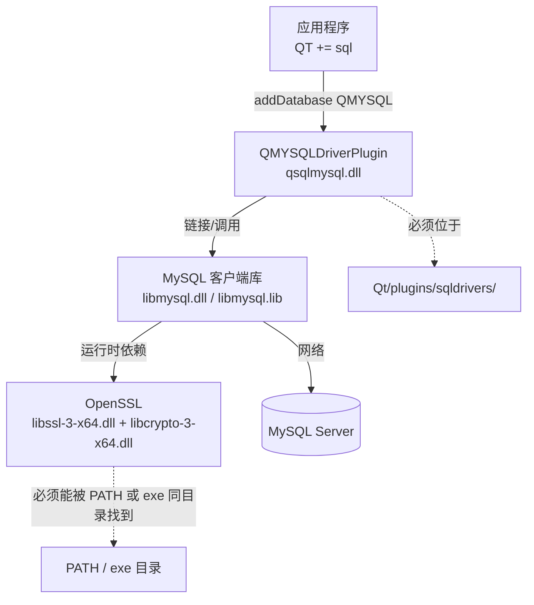
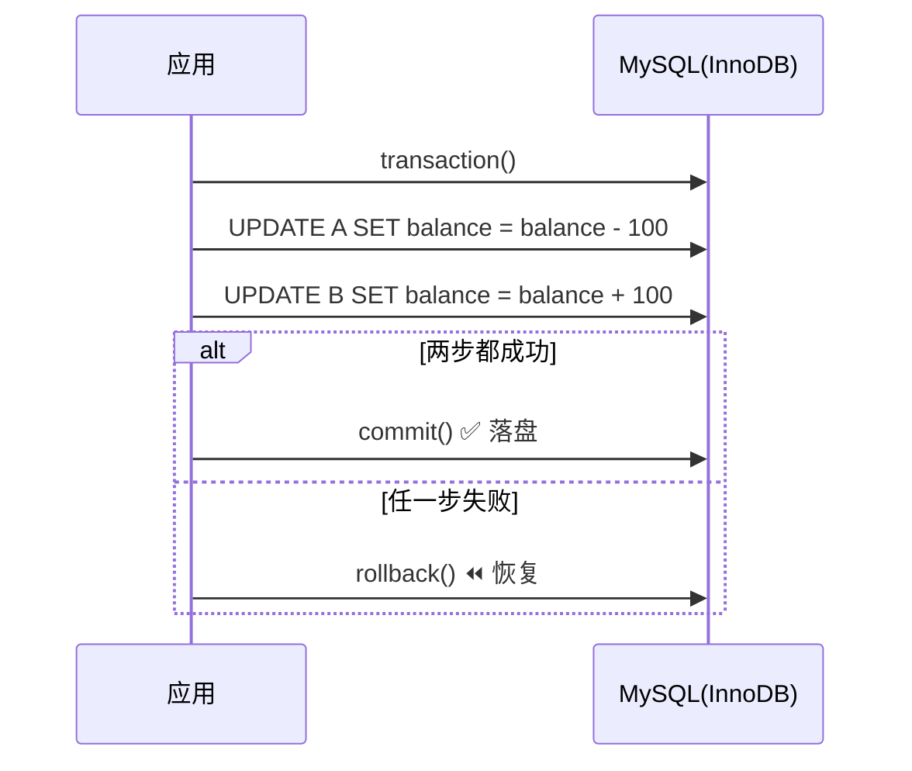

# Qt SQL 与 MySQL 驱动笔记

> [!abstract] 一句话抓住主线
> Qt 不直接连数据库，而是通过 **QSqlDriver 插件** 访问；MySQL 这条链路上存在三层依赖：`Qt 插件 → MySQL 客户端库 → OpenSSL 运行库`，缺一层就报 `QMYSQL driver not loaded`。所有 SQL 操作最终都落在某个 **QSqlDatabase 连接** 上，而连接**不能跨线程**。

## 🗺 笔记地图

- [[Qt SQL 核心类与数据模型]]
- [[Qt SQL 事务]]
- [[SQL 注入与参数绑定]]
- [[Qt 数据库操作与界面流畅度]]
- [[Qt 插件机制]]
- [[Model/View 与 QTableView]]
- [[MySQL 存储引擎 InnoDB]]

%% 以上是建议拆成的子笔记；单篇使用时直接删掉本段，双链在 Obsidian 里仍可点开新建 %%

---

## 1. 驱动是怎么被加载的

`QSqlDatabase::addDatabase("QMYSQL")` 并不自带 MySQL 实现，它按名字去 Qt 的插件目录里找一个叫 `QMYSQLDriverPlugin` 的动态库，加载后由该插件创建 `QMYSQLDriver`。这个插件又链接了 MySQL 官方的 C 客户端库 `libmysql.dll`，而后者在较新的 MySQL 8 中依赖 OpenSSL DLL。



> [!info] 三个不同的「目录」，别混在一起
> | 目录 | 里面是什么 | 谁在用 | 怎么配 |
> | --- | --- | --- | --- |
> | MySQL `include/` | `mysql.h` 等**头文件** | 编译驱动插件时 | `INCLUDEPATH` / `-DMySQL_INCLUDE_DIR` |
> | MySQL `lib/` | `libmysql.lib`（导入库）、`libmysql.dll` | 链接期 / 运行期 | `LIBS` / `-DMySQL_LIBRARY` |
> | MySQL `bin/` | `libssl-3-x64.dll`、`libcrypto-3-x64.dll` | **运行期** | 加入 `PATH`，或拷到 exe 同目录 |
> | Qt `plugins/sqldrivers/` | `qsqlmysql.dll`（Release）、`qsqlmysqld.dll`（Debug） | **运行期** | 插件必须放这里，不是 `plugins/` 根目录 |

> [!warning] 原稿里最容易踩的 3 个坑
> 1. `include/` 放的是**头文件**，不是 `libmysql.dll` / `libmysql.lib`。
> 2. **运行时只需要 PATH 能找到 DLL**（`bin/` 是关键）；`include/` 是编译期概念，加到环境变量对跑程序没有帮助，`lib/` 是链接期概念。
> 3. 插件路径是 `plugins/sqldrivers/`，少一层就报 `QMYSQL driver not loaded`。

### 1.1 版本差异（原稿未提，但很关键）

| 项 | 说明 |
| --- | --- |
| Qt 5 | 部分发行版自带 `qsqlmysql.dll`，缺失时用 qmake 编译 `qtbase/src/plugins/sqldrivers/mysql` |
| Qt 6 | 通常**不再随二进制分发 MySQL 插件**，需用 Qt 源码 + CMake 自行编译，官方参考 [SQL 数据库驱动程序](https://doc.qt.io/qt-6.8/zh/sql-driver.html) |
| MySQL ≥ 8.0.34 | `libmysql.dll` 依赖 OpenSSL **3.x**：`libssl-3-x64.dll` + `libcrypto-3-x64.dll` |
| MySQL < 8.0.34 | 依赖 OpenSSL **1.1**：`libssl-1_1-x64.dll` + `libcrypto-1_1-x64.dll`，名字不一样，别照抄 |

> [!danger] 四件事必须同时匹配，否则一律 `driver not loaded`
> 编译器位数（x64/x86）、Qt 编译器套件（MSVC / MinGW）、插件的 Debug/Release 版本、MySQL 客户端库位数与 OpenSSL 版本。MySQL 8 起官方只提供 64 位库，Qt 也得用 64 位套件。

### 1.2 部署清单

- [ ] 编译 / 获取 `qsqlmysql.dll`（及 Debug 用的 `qsqlmysqld.dll`）
- [ ] 放到 `Qt/<kit>/plugins/sqldrivers/`
- [ ] `libmysql.dll` 放到 exe 同目录（或 MySQL `bin/` 加入 `PATH`）
- [ ] 按 MySQL 版本放 `libssl-*-x64.dll` + `libcrypto-*-x64.dll`
- [ ] 确认位数、编译器、Debug/Release 四者一致
- [ ] `windeployqt` **不会**自动打包 MySQL 依赖，发布时手动补拷
- [ ] 用 [Dependencies](https://github.com/lucasg/Dependencies) 打开 `qsqlmysql.dll` / `libmysql.dll` 看缺哪个 DLL

### 1.3 Qt 6 编译插件（示意）

```bat
:: 在 Qt 源码的 sqldrivers 目录执行，路径按实际安装替换
cmake -G "Visual Studio 17 2022" -A x64 ^
  -DFEATURE_sql_mysql=ON ^
  -DMySQL_INCLUDE_DIR="C:/mysql-8.0.xx-winx64/include" ^
  -DMySQL_LIBRARY="C:/mysql-8.0.xx-winx64/lib/libmysql.lib" ^
  -DCMAKE_INSTALL_PREFIX="C:/Qt/6.x.x/msvc2022_64" ..
cmake --build . --target install --config Release
```

官方整包 configure 的写法是 `configure.bat -sql-mysql -- -DMySQL_ROOT="C:\mysql-8.0.xx-winx64"`；也可用 `CMAKE_INCLUDE_PATH` / `CMAKE_LIBRARY_PATH` 兜底。

### 1.4 先自检，再怀疑代码

```cpp
#include <QSqlDatabase>
#include <QSqlError>
#include <QDebug>

qDebug() << "可用驱动:" << QSqlDatabase::drivers();   // 没有 QMYSQL 就是插件没到位

auto db = QSqlDatabase::addDatabase("QMYSQL", "conn_main");
db.setHostName("127.0.0.1");
db.setPort(3306);
db.setDatabaseName("demo");
db.setUserName("root");
db.setPassword("xxx");

if (!db.open())
    qCritical() << "连接失败:" << db.lastError().text();
```

> [!tip] `drivers()` 里有 QMYSQL 却仍报 `Driver not loaded`
> 说明插件被找到了、但**它自己的依赖没加载成功**：查 `libmysql.dll`、OpenSSL DLL，或位数/套件不匹配。

---

## 2. 三个「查数据」的类，别混用

| | `QSqlQuery` | `QSqlQueryModel` | `QSqlTableModel` |
| --- | --- | --- | --- |
| 定位 | 执行 SQL 的**底层执行器** | 把结果集包成**只读模型** | 面向**单表**的可读写模型 |
| SQL | 任意 SQL（含 JOIN / DDL / 存储过程） | 任意 `SELECT`（`setQuery`） | 自动生成，不用手写 SQL |
| 读写 | 取决于语句 | **只读**（除非子类化改写） | **可读可写** |
| 与视图绑定 | 不直接绑，需自己塞进 model | ✅ 直接 `setModel()` | ✅ 直接 `setModel()` |
| 典型场景 | 事务、批量写、预处理、超大结果集遍历 | 报表、查询结果展示 | 后台管理表格、单表 CRUD |
| 常用 API | `prepare` / `bindValue` / `exec` / `execBatch` / `next` | `setQuery` / `record` / `data` / `fetchMore` | `setTable` / `select` / `setFilter` / `insertRecord` / `submitAll` / `revertAll` |

### 2.1 QSqlQuery：干重活的那个

```cpp
QSqlQuery q(db);
q.setForwardOnly(true);                 // 超大结果集：只向前读，省内存
q.prepare("INSERT INTO log(uid, msg) VALUES (?, ?)");

QVariantList uids, msgs;                // 批量执行
uids << 1 << 2 << 3;
msgs << "a" << "b" << "c";
q.addBindValue(uids);
q.addBindValue(msgs);
if (!q.execBatch()) qDebug() << q.lastError().text();

q.exec("SELECT id, name FROM big_table");
while (q.next()) { /* q.value(0), q.value(1) */ }
```

关键词：**任意 SQL、事务控制、预处理与参数绑定、批量执行、逐行遍历超大结果集**（原稿这几点都对）。

### 2.2 QSqlQueryModel：只读，但可扩展

只读是默认行为（重写 `flags()` 与 `setData()` 就能改成可编辑）。如果只是想编辑单表，**别费劲子类化，直接用 `QSqlTableModel`**。

### 2.3 QSqlTableModel：编辑策略比想象中重要

```cpp
auto *model = new QSqlTableModel(this, db);
model->setTable("account");
model->setEditStrategy(QSqlTableModel::OnManualSubmit);  // 攒一批再提交
model->setFilter("status = 1");
model->select();
ui->tableView->setModel(model);
// 改完：model->submitAll();  撤销：model->revertAll();
```

| 策略 | 提交时机 |
| --- | --- |
| `OnFieldChange` | 光标离开字段立即写库 |
| `OnRowChange` | 切换行时写库 |
| `OnManualSubmit` | 手动 `submitAll()` 才写，最易与事务配合 |

> [!tip] 有外键关联时
> 用 `QSqlRelationalTableModel` + `QSqlRelationalDelegate`，把外键列显示成另一张表的可读字段。

---

## 3. 事务

**事务 = 一个业务原子单元**。典型如转账：扣钱和加钱必须同时成功或同时失败，中间任何一步失败就回滚到事务开始前的状态。



```cpp
QSqlDatabase db = QSqlDatabase::database("conn_main");
if (!db.transaction()) { /* 驱动不支持事务 */ return; }

QSqlQuery q(db);   // ⚠️ 注意：transaction() 之后再创建 QSqlQuery
auto deduct = [&](int id, int amount) {
    q.prepare("UPDATE account SET balance = balance - ? WHERE id = ?");
    q.addBindValue(amount); q.addBindValue(id);
    return q.exec();
};
auto add = [&](int id, int amount) {
    q.prepare("UPDATE account SET balance = balance + ? WHERE id = ?");
    q.addBindValue(amount); q.addBindValue(id);
    return q.exec();
};

if (!deduct(1, 100) || !add(2, 100) || !db.commit()) {
    db.rollback();
    qCritical() << db.lastError().text();
}
```

> [!danger] 事务的 6 个前提与坑
> 1. 引擎必须支持事务：MySQL 用 **InnoDB**，MyISAM 不支持；先 `db.driver()->hasFeature(QSqlDriver::Transactions)`。
> 2. **先 `transaction()`，再创建 `QSqlQuery`**，否则该查询可能不在这个事务里。
> 3. 事务内的所有查询必须来自**同一个 QSqlDatabase 连接**。
> 4. 不支持嵌套事务；需要分层回滚用 `SAVEPOINT`。
> 5. `CREATE/ALTER/DROP` 等 DDL 在 MySQL 会**隐式提交**，别混进事务。
> 6. `QSqlTableModel(OnManualSubmit)` 的 `submitAll()` 与事务是两回事，可外层再包一层 `transaction()` 保证多表一致。

---

## 4. SQL 注入与参数绑定

> [!danger] 注入的本质
> 不是「输入里带引号」这么简单，而是**把用户输入当作 SQL 代码拼接**，让数据越界变成了指令。任何来自界面的字符串、文件名、配置项都不该直接拼进 SQL。

```cpp
// ❌ 危险：name = "x' OR '1'='1" 时条件恒真，甚至可叠语句
QString sql = QString("SELECT * FROM user WHERE name = '%1'").arg(name);
QSqlQuery q(db); q.exec(sql);

// ✅ 正确：SQL 模板固定，值通过占位符单独送入
QSqlQuery q(db);
q.prepare("SELECT * FROM user WHERE name = :name");
q.bindValue(":name", name);        // 也可用 ? + addBindValue()
q.exec();
```

Qt 的做法是 `prepare()` + `bindValue()` / `addBindValue()`：SQL **结构先定死**，参数值单独绑定，值永远被当作值而不是被解析为语法。部分驱动是服务端预编译，部分是驱动层做转义模拟绑定，但对调用方语义一致。

> [!warning] 占位符只能代替「值」
> 表名、列名、`ASC/DESC`、SQL 关键字**不能**绑定。动态表名只能用**白名单映射**；标识符需转义时用 `db.driver()->escapeIdentifier(name, QSqlDriver::TableName)`。
> 另外别自己手写转义函数替代绑定，字符集/连接选项一变就容易漏。

---

## 5. 数据库耗时导致界面卡顿

> [!danger] 铁律（原稿最需要补的一条）
> **一个连接只能在创建它的线程里使用**，由它产生的 `QSqlQuery` / model 同理。`moveToThread()` 自 Qt 5.10 起已弃用、Qt 6 中不应再依赖它来搬连接。正确做法是**每个工作线程自己 `addDatabase()` 一个带唯一名字的新连接**。

主线程只负责发信号、收结果、刷 UI；**不要把 `QSqlQuery` / `QSqlTableModel` 对象本身跨线程传**，只传 `QVariantList` / `QVector<结构体>` 这类纯数据。

### 方案 A：子线程（QThread / Worker）+ 独立连接

```cpp
void Worker::doQuery() {
    // 用线程地址生成唯一连接名，避免与主线程/其他线程撞名
    const QString conn =
        QString("db_%1").arg(reinterpret_cast<quintptr>(QThread::currentThread()), 0, 16);
    {
        auto db = QSqlDatabase::addDatabase("QMYSQL", conn);  // 必须在本线程创建
        db.setDatabaseName("demo");  /* ... 其他参数 ... */
        if (!db.open()) { emit failed(db.lastError().text()); return; }

        QSqlQuery q(db);
        q.exec("SELECT id, name FROM big_table");
        QVector<QPair<int, QString>> rows;
        while (q.next()) rows.append({q.value(0).toInt(), q.value(1).toString()});

        emit done(rows);      // 只把纯数据发回主线程
        db.close();
    }
    QSqlDatabase::removeDatabase(conn);  // ⚠️ 必须等上面所有 QSqlQuery/db 副本都销毁
}
```

### 方案 B：分页 / 增量加载（减少单次数据量）

```cpp
// 1) SQL 层分页：LIMIT + OFFSET（深分页改用「游标 / 上一页最大 id」更好）
q.exec("SELECT id, name FROM big_table WHERE id > :last ORDER BY id LIMIT 200");

// 2) forward-only 只向前游标，避免一次性把结果集拉进内存
q.setForwardOnly(true);

// 3) Model 层增量：QSqlQueryModel / QTableView 滚动时自动 fetchMore()
while (model->canFetchMore()) model->fetchMore();
```

配合 `setFilter()`、`LIMIT`、只 `SELECT` 需要的列、给 WHERE 字段加索引，通常比上线程更划算。

### 方案 C：`QtConcurrent::run`（原稿拼成了 QtConcurrnet）

```cpp
#include <QtConcurrent>

QFuture<QVector<Row>> future = QtConcurrent::run([] {
    // 注意：线程池里的线程不确定，连接仍要「本次调用内新建 + 用完移除」
    // 逻辑与方案 A 相同，别复用主线程的 db
    return loadRows();
});
auto *watcher = new QFutureWatcher<QVector<Row>>(this);
connect(watcher, &QFutureWatcher<QVector<Row>>::finished,
        this, [this, watcher]{ ui->tableView->setModel(buildModel(watcher->result())); watcher->deleteLater(); });
watcher->setFuture(future);
```

> [!tip] 三方案怎么选
> | 方案 | 适合 | 注意 |
> | --- | --- | --- |
> | A 独立连接子线程 | 长连接、持续监听/写入、多阶段事务 | 连接生命周期、唯一 `connectionName`、用信号回传数据 |
> | B 分页 / 增量 | 只是「一次查太多」 | 优先做，改动最小；`fetchMore` 依赖驱动支持 |
> | C `QtConcurrent::run` | 一次性异步小任务，不想管 QThread | 线程池线程不确定，**不能**持有长连接；结果回主线程再建 model |

> [!warning] 两个高频报错
> - `QSqlDatabasePrivate::removeDatabase: connection 'xxx' is still in use` → 还有 `QSqlQuery` / `QSqlDatabase` 副本活着，用作用域 `{}` 包起来再删。
> - `QObject::setParent: Cannot set parent, new parent is in a different thread` / 界面偶发崩溃 → model 在工作线程创建后直接给了主线程的 view。model 必须在主线程构建。

---

## 6. 相关类速查

| 类 | 作用 |
| --- | --- |
| `QSqlDatabase` | **连接**（注意大小写，不是 `QSqldatabase`）；`addDatabase` / `database` / `removeDatabase` / `drivers` / `transaction` |
| `QSqlDriver` | 驱动抽象；`hasFeature()` 查事务/ prepared query 支持、`escapeIdentifier()` |
| `QSqlDriverPlugin` | 插件基类，即 `qsqlmysql.dll` 的入口 |
| `QSqlQuery` | 执行 SQL、绑定参数、遍历结果、`lastError()` |
| `QSqlError` | 错误对象，排查时第一件事看 `.text()` |
| `QSqlRecord` / `QSqlField` | 一行 / 一列的元数据与值 |
| `QSqlIndex` / `QSqlResult` | 主键索引 / 底层结果集接口 |
| `QSqlQueryModel` | 只读结果模型 |
| `QSqlTableModel` | 可读写单表模型 + 编辑策略 |
| `QSqlRelationalTableModel` / `QSqlRelationalDelegate` | 外键关联显示与编辑 |
| `QtConcurrent` / `QThread` / `QFutureWatcher` | 把耗时操作移出 GUI 线程 |

> [!note] 别把 `QSqlDatabase` 当成员变量长期持有
> 官方建议用 `QSqlDatabase::database("name")` 现取现用；长期持有会干扰 `removeDatabase()` 与程序退出时的清理。

---

## 7. 报错速查表

| 现象 | 优先排查 |
| --- | --- |
| `available drivers` 里没有 `QMYSQL` | 插件没编译 / 没放进 `plugins/sqldrivers/` |
| 有 `QMYSQL` 但 `Driver not loaded` | `libmysql.dll`、OpenSSL DLL 缺失；位数 / MSVC-MinGW / Debug-Release 不匹配 |
| 提示缺 `libcrypto-3-x64.dll` | MySQL ≥ 8.0.34；老版本要的是 `libcrypto-1_1-x64.dll` |
| `Commands out of sync` | 同一连接上结果集没读完又执行了新语句；加 `q.finish()` 或用独立连接 |
| 本机好、别的机器炸 | `windeployqt` 不带 MySQL 依赖，需手动补拷 DLL |
| 中文乱码 | 库/表/连接字符集统一 `utf8mb4`，检查连接选项 |

---

## 8. 原稿 → 修订对照

| 原稿表述 | 修订后 |
| --- | --- |
| `MySql` / `msyql` / `QSqldatabase` / `QtConcurrnet` | `MySQL` / `mysql` / `QSqlDatabase` / `QtConcurrent` |
| 「libmysql.dll、libmysql.lib 在 include 下面」 | `include/` 只有头文件；`.lib` 在 `lib/`，`.dll` 在 `lib/` 或 `bin/` |
| 「bin 和 include 都加到环境变量」 | 运行期只需 `bin/` 进 `PATH`（或 DLL 拷到 exe 同目录）；`include/` 走编译期 `INCLUDEPATH`，`lib/` 走链接期 `LIBS` |
| 「qsqlmysql.dll 放到 Qt 的 plugin 目录下」 | 必须放 `plugins/sqldrivers/` |
| 未提 Qt 版本差异 | Qt 6 通常需自行用源码 + CMake 编译插件 |
| 未提 OpenSSL 版本差异 | MySQL 8.0.34 前后 DLL 名不同（`1_1-x64` vs `3-x64`） |
| 「预编译固定模板的 sql 语句」 | `prepare()` + `bindValue()` 实现**值与代码分离**；占位符只能代值，不能代表名/列名 |
| 「子线程 + 独立数据库连接」 | 方向正确，补上铁律：连接与 query/model 不可跨线程，必须线程内新建 + 用完 `removeDatabase` |
| 相关类只写了 `QSqldatabase` | 补全 `QSqlDriver`、`QSqlError`、`QSqlRecord`、`QSqlRelationalTableModel` 等 |

---

## 参考

- Qt 官方：[SQL 数据库驱动程序](https://doc.qt.io/qt-6.8/zh/sql-driver.html)
- Qt 官方：[Qt 模块中的线程支持 · 线程与 SQL 模块](https://doc.qt.io/qt-6/zh/threads-modules.html)
- Qt 官方：[QSqlDatabase Class](https://doc.qt.io/qt-6/qsqldatabase.html)
- [Dependencies](https://github.com/lucasg/Dependencies)：Windows 下查 DLL 依赖链

#Qt/SQL #数据库/MySQL
