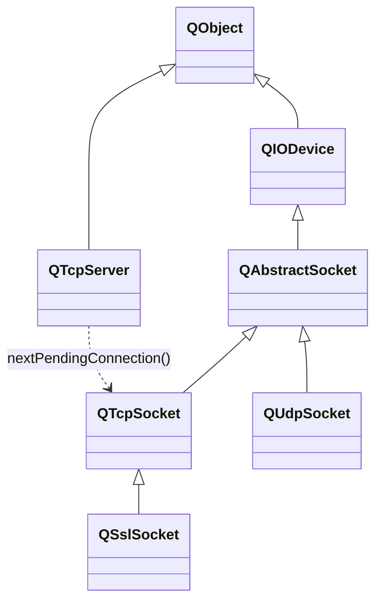
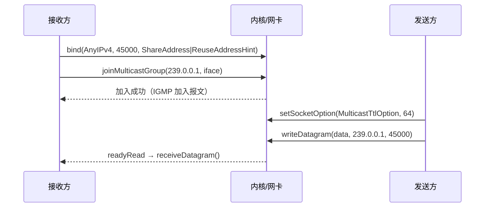

# Qt 网络编程

> [!abstract] 一句话总览
> Qt Network 把 socket 封装成了 **`QIODevice` 的子类**，所以会 `read()` / `write()` / `readyRead` 就会用 socket。
> - **TCP**：`QTcpServer`（监听）+ `QTcpSocket`（连接），面向连接、可靠、字节流
> - **UDP**：`QUdpSocket`，无连接、不可靠、数据报
> - 两者共同的抽象基类：`QAbstractSocket`

> [!warning] 先改两个笔误
> - `QTcpSetver` → **`QTcpServer`**
> - 原文「析构会自动析构子对象 QTcpServer」→ 应为 **QTcpServer 析构会自动析构它 accept 出来的 QTcpSocket 子对象**

---
## 1. 类族与继承关系



> [!note] 关键区分：**组合 ≠ 继承**
> `QTcpServer` **不是** `QTcpSocket` 的父类，它自己直接继承 `QObject`。
> 二者是 **父子对象（parent-child）关系**：server 把 accept 出来的 socket `setParent(this)`，挂进对象树。
> 所以 **server 析构 → 对象树递归析构 → 所有 client socket 自动 delete**，不用手动管。

---
## 2. 周边支撑类

### 2.1 QHostInfo —— 主机名 ↔ IP 解析
做 DNS 正向/反向查询。

```cpp
// 阻塞式
QHostInfo info = QHostInfo::fromName("www.baidu.com");
foreach (const QHostAddress &a, info.addresses())
    qDebug() << a.toString();

// 非阻塞式（推荐，不卡 UI）
int id = QHostInfo::lookupHost("www.baidu.com", this, [](const QHostInfo &info){
    qDebug() << info.hostName() << info.addresses();
});
```

### 2.2 QNetworkInterface —— 本机网卡只读信息
描述「本机的一块网卡」：IP、掩码、MAC、状态标志。**不收发数据、不建连接、没有信号**，纯粹是查询工具。

```cpp
// 典型用途一：枚举所有网卡
for (const QNetworkInterface &iface : QNetworkInterface::allInterfaces()) {
    if (!(iface.flags() & QNetworkInterface::IsUp))   continue;
    if (iface.flags() & QNetworkInterface::IsLoopBack) continue;
    qDebug() << iface.name() << iface.humanReadableName() << iface.hardwareAddress();
    for (const QNetworkAddressEntry &e : iface.addressEntries())
        qDebug() << "  IP:" << e.ip().toString() << " Mask:" << e.netmask().toString();
}

// 典型用途二：快速拿本机所有 IP
QList<QHostAddress> ips = QNetworkInterface::allAddresses();

// 典型用途三：由 IP 反查网卡（组播指定网卡必用）
QNetworkInterface iface = QNetworkInterface::interfaceFromName("eth1");
```

> [!tip] 三类典型用途
> 1. 找本机 IP
> 2. 判断网络是否可用（`IsUp` / `IsRunning`）
> 3. 子网 / 地址归属计算（`QNetworkAddressEntry::netmask()`）

### 2.3 QAbstractSocket —— 共同抽象基类
`QTcpSocket` / `QUdpSocket` / `QSslSocket` 的共同基类（同时继承 `QObject` + `QIODevice`），统一封装连接状态机、错误码、本地/对端地址、读写缓冲、阻塞等待。**不能实例化。**

| 常用接口 | 作用 |
| ---- | ---- |
| `state()` | 连接状态：`UnconnectedState` / `HostLookupState` / `ConnectingState` / `ConnectedState` / `ClosingState` / `BoundState` |
| `peerAddress()` / `peerPort()` | 对端地址端口 |
| `localAddress()` / `localPort()` | 本端地址端口 |
| `error()` / `errorString()` | 错误码与描述 |
| `waitForConnected()` / `waitForReadyRead()` / `waitForBytesWritten()` | 阻塞等待（**别在主线程用**） |
| `abort()` / `close()` | 立即断开 / 优雅关闭 |
| `isValid()` | socket 描述符是否有效 |

> [!important] 你的理解是对的
> `QAbstractSocket` 主要就是用来**判断状态**的：连接状态、IP 类型（IPv4/IPv6，`QHostAddress::protocol()`）、对端是谁。
> 真正的收发由子类实现——TCP 是流，UDP 是数据报。

---
## 3. TCP 通信

### 3.1 客户端流程
```
创建 QTcpSocket
  → connectToHost(ip, port)          // 异步，立即返回
  → 绑定 connected() / readyRead() / disconnected() / errorOccurred()
  → readyRead 里 read() / readAll()
  → write() 发送
  → disconnectFromHost() / deleteLater()
```

```cpp
class TcpClient : public QObject {
    Q_OBJECT
    QTcpSocket *sock = nullptr;
public:
    explicit TcpClient(QObject *parent = nullptr) : QObject(parent) {
        sock = new QTcpSocket(this);           // 挂进对象树
        connect(sock, &QTcpSocket::connected,    this, []{ qDebug() << "已连接"; });
        connect(sock, &QTcpSocket::readyRead,    this, &TcpClient::onReadyRead);
        connect(sock, &QTcpSocket::disconnected, this, []{ qDebug() << "断开"; });
#if QT_VERSION >= QT_VERSION_CHECK(5,15,0)
        connect(sock, &QAbstractSocket::errorOccurred,
                this, [this](QAbstractSocket::SocketError){ qDebug() << sock->errorString(); });
#else
        connect(sock, SIGNAL(error(QAbstractSocket::SocketError)), this, SLOT(onErr()));
#endif
        sock->connectToHost("127.0.0.1", 8888);
    }
    void send(const QByteArray &data) { sock->write(data); }   // 异步，返回入队字节数
private slots:
    void onReadyRead() {
        QByteArray buf = sock->readAll();      // TCP 是流，读多少算多少
        qDebug() << "recv:" << buf;
    }
};
```

### 3.2 服务端流程
```
new QTcpServer
  → listen(QHostAddress::Any, port)      // 开始监听
  → 方式A：连接 newConnection() 信号 → nextPendingConnection() 取 socket
    方式B：重写 incomingConnection(qintptr handle) 自己接管描述符
  → 对每个 client socket 绑 readyRead / disconnected
  → client 断开时 deleteLater()
```

```cpp
class TcpServer : public QTcpServer {
    Q_OBJECT
public:
    explicit TcpServer(QObject *parent = nullptr) : QTcpServer(parent) {
        connect(this, &QTcpServer::newConnection, this, &TcpServer::onNewConnection);
        if (!listen(QHostAddress::Any, 8888))
            qCritical() << "listen failed:" << errorString();
    }
private slots:
    void onNewConnection() {
        while (QTcpSocket *c = nextPendingConnection()) {   // 取出的 socket 以 this 为 parent
            qDebug() << "client in:" << c->peerAddress().toString() << c->peerPort();
            connect(c, &QTcpSocket::readyRead, c, [c]{
                qDebug() << "[" << c->peerPort() << "]" << c->readAll();
                c->write("ack");                            // 原路回显
            });
            connect(c, &QTcpSocket::disconnected, c, &QObject::deleteLater);
        }
    }
protected:
    // 方式B：需要自己控制 socket 归属（比如挪到子线程）时重写
    void incomingConnection(qintptr handle) override {
        QTcpSocket *c = new QTcpSocket(this);
        c->setSocketDescriptor(handle);                     // 接管原生描述符
        // ……绑定信号，同上
    }
};
```

> [!tip] 两种取 socket 方式怎么选
> | 方式 | 适用场景 |
> | ---- | ---- |
> | `nextPendingConnection()` + `newConnection` 信号 | 常规用法，最省事，socket 自动归 server 管 |
> | 重写 `incomingConnection()` | 要把 socket 挪到**子线程**（`moveToThread`）、自定义 socket 子类、连接池限流 |

> [!warning] TCP 三大坑
> 1. **粘包/拆包**：`readAll()` 拿到的不一定是完整一包，必须自定义协议（长度头 / 分隔符）+
>    `QDataStream` 或环形缓冲。
> 2. **`write()` 是异步的**：返回的是**入队字节数**，不代表已发送完；要确认写完用
>    `bytesWritten(qint64)` 信号或 `waitForBytesWritten()`。
> 3. **别在主线程阻塞等待**：`waitForConnected()` / `waitForReadyRead()` 会冻结 UI，
>    一律走信号槽。

---
## 4. UDP 通信

### 4.1 UDP 与 TCP 的本质差异

| 维度 | TCP | UDP |
| ---- | ---- | ---- |
| 连接 | 面向连接（三次握手） | **无连接**，直接发 |
| 可靠性 | 可靠、按序、重传 | 不保证到达、不保证顺序、可能重复 |
| 数据边界 | **字节流**，无边界（会粘包） | **数据报**，一次 `writeDatagram` = 一个包，边界天然保留 |
| 服务端角色 | `QTcpServer` 监听 + accept 出多个 socket | **没有 Server 类**，一个 `QUdpSocket` 既能发也能收 |
| 一对多 | 每个连接一个 socket | 天然支持单播 / 广播 / 组播 |
| 常用 API | `write` / `read` | `writeDatagram` / `readDatagram`、`receiveDatagram` |
| 典型场景 | 文件传输、登录、指令 | 音视频、心跳、局域网设备发现、日志上报 |

> [!note] 核心心智模型
> UDP **没有"服务器"概念**，只有"谁绑了端口谁就能收"。
> 所以 UDP 侧不区分客户端/服务端类，只有 `QUdpSocket` 一个角色。

### 4.2 基本收发流程
```
发送方：QUdpSocket sock;  sock.writeDatagram(data, addr, port);   // 不需要 bind（内核自动分配临时端口）
接收方：QUdpSocket sock;  sock.bind(port);                        // 必须先绑定端口
        connect(&sock, &QUdpSocket::readyRead, ...);
        槽里 while (hasPendingDatagrams()) { readDatagram / receiveDatagram }
```

```cpp
// ===== 接收端 =====
QUdpSocket rx;
rx.bind(QHostAddress::AnyIPv4, 9999, QUdpSocket::ShareAddress);
connect(&rx, &QUdpSocket::readyRead, [&]{
    while (rx.hasPendingDatagrams()) {
        QByteArray buf;
        buf.resize(rx.pendingDatagramSize());
        QHostAddress from; quint16 fromPort;
        rx.readDatagram(buf.data(), buf.size(), &from, &fromPort);
        qDebug() << from.toString() << fromPort << buf;
    }
});

// ===== 发送端 =====
QUdpSocket tx;
tx.writeDatagram("hello", QHostAddress("127.0.0.1"), 9999);
```

### 4.3 推荐写法：QNetworkDatagram
Qt 5.8+ 引入，把 **载荷 + 发送方地址端口 + 目标地址端口 + 跳数 + 接口索引** 全封装了，比 `readDatagram` 更完整。

```cpp
connect(&rx, &QUdpSocket::readyRead, [&]{
    while (rx.hasPendingDatagrams()) {
        QNetworkDatagram dg = rx.receiveDatagram();
        if (dg.data().isEmpty()) continue;
        qDebug() << "from" << dg.senderAddress().toString() << dg.senderPort()
                 << "to" << dg.destinationAddress().toString()
                 << "hop" << dg.hopLimit()
                 << "payload" << dg.data();

        // 原路回复：懒人写法，直接把收到的 datagram 改数据发回去
        rx.writeDatagram(QNetworkDatagram("pong", dg.senderAddress(), dg.senderPort()));
    }
});
```

| QNetworkDatagram 接口                          | 含义                                       |
| -------------------------------------------- | ---------------------------------------- |
| `data()`                                     | 载荷                                       |
| `senderAddress()` / `senderPort()`           | **谁发的**（回复时用它）                           |
| `destinationAddress()` / `destinationPort()` | 发到的目标，可能是广播/组播地址，不一定是本机电口 IP             |
| `hopLimit()`                                 | IPv4 下即 TTL                              |
| `interfaceIndex()`                           | 接收网卡索引，与 `QNetworkInterface::index()` 对应 |

> [!warning] 跨平台注意
> 部分操作系统拿不到上述全部元数据，取不到的字段会是 null / -1。
> `writeDatagram()` 时设不了的元数据会被**静默丢弃**，不报错。

### 4.4 广播（Broadcast）
```cpp
QUdpSocket sock;
sock.setSocketOption(QAbstractSocket::BroadcastSocketOption, 1);   // 部分平台需要显式开启
sock.writeDatagram("who's there?", QHostAddress::Broadcast, 9999); // 255.255.255.255
```
- 限制：**只在当前网段**，路由器不转发广播包
- 同网段所有主机都会收到 → 有"广播风暴"风险，能不用就不用

### 4.5 组播（Multicast）—— 推荐
只发给"加入了该组"的成员，不打扰无关主机，可跨网段（需路由器支持 IGMP）。



```cpp
// ===== 接收端 =====
QUdpSocket rx;
rx.bind(QHostAddress::AnyIPv4, 45000,
        QUdpSocket::ShareAddress | QUdpSocket::ReuseAddressHint);
rx.setSocketOption(QAbstractSocket::MulticastLoopbackOption, 0);  // 关回环：不收自己发的
QNetworkInterface iface = QNetworkInterface::interfaceFromName("eth1");
if (!rx.joinMulticastGroup(QHostAddress("239.0.0.1"), iface))     // 多网卡必须指定
    qWarning() << rx.errorString();

// ===== 发送端 =====
QUdpSocket tx;
tx.setSocketOption(QAbstractSocket::MulticastTtlOption, 64);      // 默认 1，跨网段要调大
tx.writeDatagram("discover", QHostAddress("239.0.0.1"), 45000);

// ===== 退出 =====
rx.leaveMulticastGroup(QHostAddress("239.0.0.1"), iface);         // 参数要与 join 一致
```

> [!tip] 组播地址规划
> - `224.0.0.0/24`：协议保留（如 `224.0.0.1` 所有主机、`224.0.0.10` EIGRP），**别用**
> - `239.0.0.0/8`：管理范围组播（私用），应用直接用 `239.x.x.x` 最稳
> - `239.255.255.250:3702`：**SSDP / ONVIF 设备发现**标准地址，摄像头/打印机搜索都用它

> [!warning] 组播五大坑
> | 现象 | 原因 | 处理 |
> | ---- | ---- | ---- |
> | `bind` 失败 | 端口被占 | 加 `ShareAddress │ ReuseAddressHint` 或换端口 |
> | 自己收到自己发的 | 回环默认开 | `MulticastLoopbackOption = 0` |
> | join 返回 false | 用了 IPv6 / `Any` 去加 IPv4 组 | **必须 `QHostAddress::AnyIPv4` 绑定** |
> | 本机收得到、跨机收不到 | 多网卡绑错口 | `joinMulticastGroup` 第二个参数显式传 `QNetworkInterface` |
> | 跨网段不通 | TTL=1 / 交换机没开 IGMP Snooping | 调大 `MulticastTtlOption`；换交换机或关该特性测试 |
> | 虚拟机之间不通 | 网络模式是 NAT | 改**桥接**，并勾选 VMware Bridge Protocol |

---
## 5. 通用要点与排错

> [!important] 对象树是内存管理的命脉
> ```cpp
> QTcpSocket *s = new QTcpSocket(this);   // ✅ parent 在栈上/堆上都会自动回收
> QTcpSocket *s = new QTcpSocket;         // ❌ 裸指针，断线后忘 delete 就泄漏
> ```
> client socket 一律 `new Xxx(this)`，或在 `disconnected` 里 `deleteLater()`——
> **不能在 disconnected 槽里直接 `delete` 自己**，槽还没返回对象就没了，用 `deleteLater` 推迟到事件循环。

> [!tip] 多线程模型
> 一个 server 带几千连接时，别让所有 socket 都住在主线程：
> 重写 `incomingConnection()` → `socket->setSocketDescriptor(h)` → `socket->moveToThread(worker)`
> 把连接分发到固定数量的工作线程（经典 one-loop-per-thread）。

| 现象 | 排查方向 |
| ---- | ---- |
| `connectToHost` 一直不 connected | `errorString()`；防火墙；端口没 listen；`state()` 看卡在哪一阶段 |
| 能连上但收不到数据 | 是否忘了 `connect(readyRead)`；对方是否真的 `write` 了；TCP 粘包导致你在等一个永远不完整的包 |
| `write` 返回 -1 | socket 已断开 / `isValid()` 为 false |
| UDP 收不到 | 是否 `bind` 了；绑定地址用了 `AnyIPv6` 却发 IPv4；防火墙拦 UDP 端口 |
| 中文乱码 | 统一 `QString::toUtf8()` / `fromUtf8()`，别用 `toLocal8Bit` 跨机器传 |
| 程序退出崩溃 | socket 被手动 delete 两次，或 parent 已析构又访问 → 全交给对象树 |

---
## 6. 速查表

| 类 / 接口 | 归属 | 用途 |
| ---- | ---- | ---- |
| `QTcpServer::listen()` | TCP 服务端 | 开始监听端口 |
| `QTcpServer::newConnection()` | 信号 | 有新连接到来 |
| `QTcpServer::nextPendingConnection()` | TCP 服务端 | 取出已连接的 `QTcpSocket*` |
| `QTcpServer::incomingConnection()` | 虚函数 | 重写以自定义 socket 归属/线程 |
| `QTcpSocket::connectToHost()` | TCP 客户端 | 异步发起连接 |
| `QUdpSocket::bind()` | UDP 接收方 | 绑定本地端口（发送方可省） |
| `QUdpSocket::writeDatagram()` | UDP | 发一个数据报 |
| `QUdpSocket::readDatagram()` | UDP | 读一个数据报（老接口） |
| `QUdpSocket::receiveDatagram()` | UDP | 读 `QNetworkDatagram`（推荐） |
| `QUdpSocket::hasPendingDatagrams()` | UDP | 缓冲区是否还有包 |
| `joinMulticastGroup()` / `leaveMulticastGroup()` | UDP 组播 | 加入/离开组播组 |
| `QAbstractSocket::state() / peerAddress() / errorString()` | 共用 | 状态查询 |
| `QHostInfo::lookupHost()` | 辅助 | 异步 DNS 解析 |
| `QNetworkInterface::allInterfaces()` | 辅助 | 枚举本机网卡 |
| `QNetworkInterface::interfaceFromName()` | 辅助 | 按名字取网卡（组播指定） |

> [!question] 一句话总结
> **TCP 靠"连接"分角色（Server 监听、Socket 通信），UDP 只有 socket 没角色；**
> **所有 socket 都是 QIODevice，会 read/write/readyRead 就已经会一半了，剩下的是粘包、对象树和线程归属这三件事。**